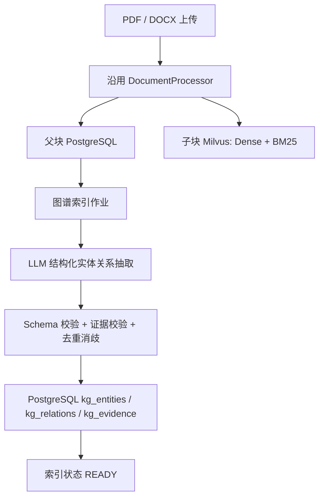
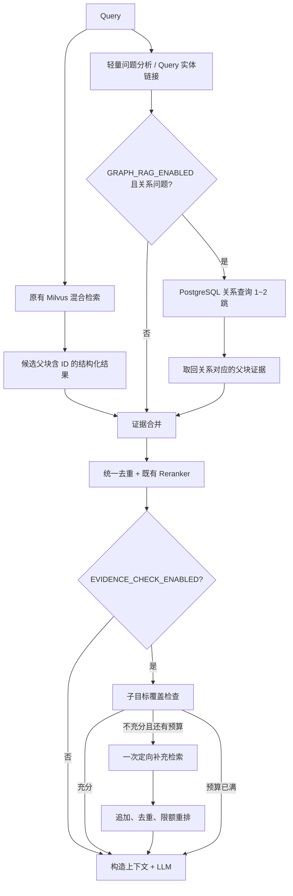
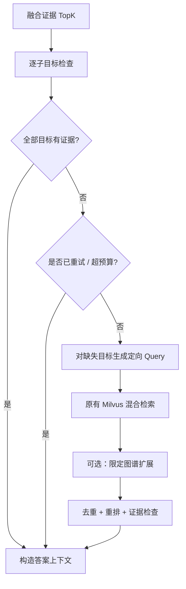

# EchoMind RAG 准确性提升三阶段开发实施计划（Codex 执行版）

> 文档版本：v1.0  
> 编写日期：2026-10-21  
> 目标仓库：<https://github.com/Dreamt0511/EchoMind>  
> 目标分支：仓库当前默认的 `master`；**Codex 开始开发时必须记录实际 `git rev-parse HEAD`，以本地检出源码为准**。  
> 目的：以**最小侵入、可回退、可测量**的方式，在既有 Milvus 混合 RAG + Parent-Child + Reranker 基础上加入**轻量知识图谱辅助召回**和**证据完整性检查**，提高知识库复杂问题的回答准确性。

---

## 最新实施记录 2026-10-23：代理审核与受控启用

用户明确要求以独立子代理完成审核，并授权三份真实文档通过现有DashScope模型建图。100题Gold、两轮各72次真实回答、图谱实现及14条真实关系引用均已代理复核；新版Gold、原始失败和逐断言审核独立保留，不将代理审核改写为真人签核。

已修复回填推进、抽取Schema格式反馈、来源包装及评测证据解析；新增线上方向与肯定关系守卫，14条存储关系中9条拒绝在线扩展、5条可召回。真实库3份文档/136父块全部READY，当前用户图谱召回已保存开启，其他偏好及画像保留；新增文档自动抽取和证据检查仍关闭。

交付回归：后端120项、前端19项、核心评测27项和专用环境RAGAS适配1项通过；100题零模型回放的证据集合与指标均保持一致。回答仍有引用遗漏和范围外推，不能宣称生产答案100%准确。历史各阶段的Gate及实验源码指纹不追写，新受控启用依据与范围见 [启用记录](rag_accuracy/04_activation_report.md)、[回答审核](rag_accuracy/04_answer_delivery_agent_review.md) 和 [manifest](rag_accuracy/phase4_manifest.json)。

---

## 本地实施记录 2026-10-21

阶段一工程及真实配对实验已落地，详见 [阶段一报告](rag_accuracy/01_baseline_report.md)、
[逐题对照](rag_accuracy/01_paired_results.md) 和 [运行说明](../evaluation/RAG_ACCURACY.md)。
起点为已有未提交改动的实际工作区，原始 Git SHA、源码指纹及环境在 `rag_accuracy/baseline_manifest.json`。

本地已存在 RAGAS/计时及部分来源治理，因此复用 `evaluation/`，没有重复创建 `eval/`。
两组各运行 100 题，暂定 Recall@5 均为 92.05%，CompleteEvidence@5 均为 82.95%，不是准确率提升。
15 道证据不完整题的缺失来源已进入候选池，随后被重排挤出 Top5；后续应重点验证有效关系路径的证据保留配额，
并分别衡量新增召回收益和重排保留收益。

100 题均为可溯源的合成标注草稿，尚未完成人工审核，正式阶段一 Gate 未通过。
依照本计划的停止规则，阶段二/三暂未实现，相关预留开关保持关闭。

---

## 第二阶段实施记录 2026-10-22

按用户继续下一步的要求，已实现默认关闭的 PostgreSQL 图谱、独立抽取作业、两跳证据查询、路径配额、
跨文件重复来源修复及删除补偿。详见 [第二阶段报告](rag_accuracy/02_graph_results.md) 和
[回填与回滚](rag_accuracy/02_graph_reindex.md)。原有未提交修改继续保留，真实用户知识库未回填。

同一 100 题合成标注集上，CompleteEvidence@5 暂定从 82.95% 到 95.45%；两跳题从 60% 到 100%。
这是检索证据指标，不是答案准确率。人工审核门槛仍未通过，未修改 Gold 审核状态，阶段三尚未实施。

---

## 0. 一页结论：这次究竟要做什么

> **第三阶段实施更新（2026-10-22）：** 按用户继续下一步的要求，已实现默认关闭的原始问题子目标检查、连续引文验证、至多一次同范围补检、完整证据组保留及有上限的上下文。原画像、记忆与 Agent 工具调用上限保持不变。设置面板已增加实验开关。
>
> 同一隔离语料、相同模型与 K=5 的四组各 100 题实时实验已完成。88 道有答案题的 CompleteEvidence@5：A=82.95%、B=95.45%、C=96.59%、D=100%。D 补齐原先 Q045/Q050/Q055/Q060 的手册缺口；C 有两题降级，D 有一次其他阶段降级，全部原始记录保留。这是证据指标，不是生产答案准确率。
>
> 开发中修正了重排客户端重复证书初始化造成的本地阻塞，并在最终四组统一使用该修正；初次并发与中断运行保留。原始问题被工具改写漏项、截断流程、多故障归属和显式时态等边界另外收紧，经原始语料及最终覆盖一致性复核，不冒充第二轮云实测。
>
> 结果、源码指纹和当前限制见 [第三阶段报告](rag_accuracy/03_ablation_report.md)、[实现说明](rag_accuracy/03_evidence_check.md) 与 [回滚说明](rag_accuracy/03_rollout_and_rollback.md)。100 题 Gold 仍待人工审核，正式效果 Gate 未宣称通过，真实用户开关和知识库保持原状态。

不是重写 EchoMind，不是实现微软完整版 GraphRAG，也不是做图算法论文。

我们只做三阶段：

| 阶段 | 核心目标 | 本阶段必须交付 | 阶段完成标志 |
|---|---|---|---|
| **阶段一：评测基线与检索链路治理** | 知道原系统错在哪里、具备可比较的证据链 | 固定测试集、离线评测脚本、结构化检索结果与追踪、现有链路回归 | 可以重复运行 baseline 并输出指标与问题明细 |
| **阶段二：轻量图谱辅助召回** | 补全传统检索遗漏的实体关系证据 | PostgreSQL 小型实体关系图、离线抽取与重建、Query 种子、1–2 跳查询、证据融合、开关 | 关系类问题可检索到跨文档证据；关闭开关保持原行为 |
| **阶段三：证据检查与对照实验** | 防止只找到部分证据就直接回答，并量化收益 | 子问题证据覆盖检查、至多一次补充检索、消融实验、报告、回滚预案 | 能解释哪些题提升、哪些题变差、成本是否可接受 |

**必须遵守：**

1. 不改动长期记忆、用户画像等非目标模块；本计划仅针对 `search_knowledge_base` 这一知识库 RAG 工具。
2. 保留现有 Milvus HNSW/BM25/RRF、PostgreSQL 父块、重排序及两层降级能力。
3. **第一阶段不得以“优化后的成绩”冒充旧系统基线。** 修改前先保存原始 baseline 数据、环境、配置和 Git SHA。
4. 所有新能力受配置开关控制，出现超时、抽取失败、图谱缺失时回退到已有检索流程。
5. 禁止编造效果提升百分比；验收指标是目标值/门槛，必须由真实测量验证。
6. 图谱只用于**关联证据**，不直接把“LLM 抽出的关系”当作无需引用的事实。
7. 默认不引入 Neo4j、图神经网络、复杂社区发现、Beam Search、自动路径学习等高成本方案。

---

## 1. 对 EchoMind 现有源码的核对结果

> 以下对应 2026-10-21 公开仓库可见代码。部分方法、表、字段可能随之后提交改变；Codex 应先复核，不可照抄假定路径。

### 1.1 已有组件，直接复用

| 实际文件 | 实际代码/能力 | 本次改造位置 |
|---|---|---|
| `backend/tools.py` | `search_knowledge_base(query, runtime)`：拿 `user_id`、`knowledge_base_id`、`top_k`，调用 Milvus → PostgreSQL → Reranker，最后拼成纯文本 | 保持对外工具名和签名；内部调用新检索服务 |
| `backend/knowledeg_base_manager.py` | `KnowledgeBaseManager.hybrid_retrieval_knowledge_base`：Milvus 稠密检索 + 内置 BM25 + `RRFRanker`；返回 `parent_id` 列表 | 增加可选结构化结果方法；保留旧方法兼容。**文件名确实拼写为 `knowledeg`，不要擅自改名。** |
| `backend/milvus_client.py` | `AsyncMilvusClientWrapper`，代理知识库检索和子块写入 | 尽量增加薄代理，不破坏现有调用 |
| `backend/documents_process.py` | `DocumentProcessor.process_document`：父子块切分、上传与哈希去重；`rerank_documents` 调外部 API | 保留文档处理；在索引成功后增加图谱构建触发点 |
| `backend/postgresql_client.py` | `PostgreSQLParentClient`，已有 `parent_chunks`、`file_metadata`、`knowledge_bases`、`chunk_hashes` 等表；`get_parents()` 当前只返回字符串 | 增加“保留 metadata 与 ID”的查询/仓储接口；新增图谱专用表及访问层 |
| `backend/api.py` | `/document_upload` 后台执行文档处理；删除文件/知识库接口 | 挂接图谱索引作业与清理；不要修改原接口契约 |
| `backend/agent.py` | Agent 使用 `search_knowledge_base` 工具，`ContextSchema(top_k=5)`；工具调用限制 `run_limit=1` | **补充检索必须发生在工具内部**，不要要求 Agent 再调用第二次工具 |
| `backend/config.py` | 现有提示词和切分参数：父块 1000/200，子块 200/50 | 新增图谱/证据检查配置；不全局重写提示词 |
| `backend/hash_storage.py` | 文件哈希与子块哈希去重 | 复用但须处理跨文件复用与来源删除的一致性 |

源文件链接：

- [README](https://github.com/Dreamt0511/EchoMind/blob/master/README.md)
- [tools.py](https://github.com/Dreamt0511/EchoMind/blob/master/backend/tools.py)
- [knowledeg_base_manager.py](https://github.com/Dreamt0511/EchoMind/blob/master/backend/knowledeg_base_manager.py)
- [documents_process.py](https://github.com/Dreamt0511/EchoMind/blob/master/backend/documents_process.py)
- [postgresql_client.py](https://github.com/Dreamt0511/EchoMind/blob/master/backend/postgresql_client.py)
- [api.py](https://github.com/Dreamt0511/EchoMind/blob/master/backend/api.py)

### 1.2 当前链路中会影响图谱集成与评测的真实问题

1. `hybrid_retrieval_knowledge_base` 把结果 `parent_id` 转成 `set` 再转 `list`，**可能打乱 RRF 原有顺序**。不应把去重后的顺序当作模型排名。
2. `get_parents()` 只返回 `List[str]`，丢失 `parent_id`、`file_hash`、`knowledge_base_id` 等信息；Reranker 后又根据文本组装，导致最终答案难以追溯证据来源。
3. Milvus 子块主键为自动生成的整数 `id`，现有 `metadata` 中有 `child_chunk_hash` 和 `parent_id`，但并无专门稳定的业务子块 ID。**本次 MVP 可用稳定存在的 `parent_id` 做图谱证据外键，不强制迁移 Milvus 主键**。
4. `DocumentProcessor` 当前对跨文件重复子块可能跳过向 Milvus 写入；而父块仍独立生成。这意味着“重复内容所在的新文件”的子块可检索性/溯源性可能与父块不完全一致。阶段一记录风险，阶段二验证并修复关联，不要随意删除去重机制。
5. 文档上传通过 FastAPI `BackgroundTasks` 异步执行，**接口返回成功不意味着向量索引已完成**。图谱索引要有独立状态和重试机制。
6. `api.py` 删除文件、知识库的流程先删 PostgreSQL，再删 Milvus；新图谱表必须同步清理，且要针对跨系统部分失败提供可恢复的补偿方式。
7. `knowledge_base_id == "默认知识库"` 在旧系统中是用户范围的“跨知识库检索”，不是实际知识库所有权字段。**图谱存储不得把“默认知识库”当作一个实体所属知识库，查询时只把它解析为当前用户全部授权知识库**。
8. 当前 Agent 有查询改写提示词和动态提示词；本次评测应区分“直接调用检索核心”与“Agent 是否选择/改写并调用工具”，否则很难定位误差来源。

### 1.3 设计原则及边界

- **不新建独立对话入口**：继续走 `search_knowledge_base`，前端不必重写。
- **先结构化检索结果，再做图谱**：确保父块 ID、文件及知识库来源全程存在。
- **Query 中出现明确实体时直接链接为图种子**；Query 无明确或有歧义时，才使用向量召回的 Chunk 实体补充。不必先做复杂的种子打分模型。
- **在线图检索只做关系类型过滤、最多两跳、严格候选上限**，不无限扩展。
- **优先恢复证据父块**：知识图谱边必须能指回有效的 `parent_chunks`，不是只返回漂亮的路径字符串。
- **功能开关与观测先行**：可逐步灰度，上线失败可立即关闭。

---

## 2. 总架构与统一数据契约

### 2.1 离线索引



### 2.2 在线检索



### 2.3 结构化检索数据模型（建议）

阶段一创建 `backend/rag/types.py`（或与项目风格一致的路径），所有步骤使用一致的候选结构：

```python
from dataclasses import dataclass, field
from typing import Literal

@dataclass
class RetrievalCandidate:
    parent_id: str
    user_id: int
    knowledge_base_id: str
    file_hash: str
    file_name: str
    text: str
    source: Literal["dense", "bm25", "rrf", "graph", "fallback"]
    rank: int | None = None
    score: float | None = None
    evidence_relation_ids: list[str] = field(default_factory=list)

@dataclass
class RetrievalTrace:
    request_id: str
    query: str  # 只用于受控调试/评测；生产日志中避免记录原文
    retrieval_mode: str
    steps_ms: dict[str, float]
    candidate_parent_ids: list[str]
    final_parent_ids: list[str]
    graph_used: bool
    fallback_reason: str | None = None
```

注意：

- Milvus 返回的是**子块命中**，统一候选是**父块**；应保留“子块命中 → 父块”的映射、首个排名和对应分数以便调试。
- 当同一父块由多路召回时，来源使用 `sources: list[str]` 会比单个 `source` 更准确；上面结构为简化示例，Codex 实现时应采用多来源字段。
- `score` 可能属于不同分数空间，**不要直接把 RRF 排名分、Milvus 向量距离、Reranker 相关度相加**；初版以保序并将统一 Reranker 作为最终文本排序器。
- 为降低改动面，可以新增 `get_parents_with_metadata`，原 `get_parents` 保留供旧路径调用。
- **身份过滤必须在底层 SQL / Milvus 查询执行，不允许只在 Python 结果返回后过滤。**

### 2.4 Feature Flags（默认关闭）

建议在 `.env.example` 增加：

```dotenv
# 三阶段独立开关；未配置时全部为 false
RAG_TRACE_ENABLED=false
GRAPH_RAG_ENABLED=false
EVIDENCE_CHECK_ENABLED=false

# 在线图检索，仅为初始实验参数
GRAPH_MAX_HOPS=2
GRAPH_MAX_SEEDS=3
GRAPH_MAX_RELATIONS=20
GRAPH_MAX_EVIDENCE_PARENTS=5
GRAPH_QUERY_TIMEOUT_MS=400

# 文档索引；实际使用的模型由现有兼容客户端注入
GRAPH_EXTRACTION_ENABLED=false
GRAPH_EXTRACTION_VERSION=v1
GRAPH_EXTRACTION_BATCH_SIZE=10

# 证据检查：最多补一次
EVIDENCE_MAX_RETRIEVAL_ROUNDS=1
EVIDENCE_EXTRA_PARENT_LIMIT=3
EVIDENCE_CHECK_TIMEOUT_MS=800
```

运行时间阈值只是**开发初始配置**；须根据本地性能与测试集调整。布尔配置务必显式解析 `true/false`，避免 Python 把字符串 `"false"` 当作 True。

---

# 阶段一：建立旧 RAG 的评测基线与可追溯检索链路

## 3. 阶段一目标与范围

**目标：** 在不先引入图谱的前提下，让 Codex 能准确回答：RAG 错误发生于哪一环？同一数据下新算法是否真的带来收益？

主要输出：

- 真实可执行的固定评测数据集（建议 100 题；先用 20 题贯通工具链，再扩展）。
- Baseline 配置快照、基线结果 JSONL、误差分析。
- 结构化检索记录（保留 ID、来源、排名、文件元数据）。
- 可重复运行的检索级与答案级离线评测命令。
- 完整单元测试/集成测试；**GRAPH_RAG_ENABLED=false 时旧行为仍可运行**。

## 4. 阶段一开发流程

### S1-01：冻结环境、确认既有链路

Codex 执行：

1. `git status --short`；保留用户已有修改，不直接覆盖。
2. `git rev-parse HEAD`、Python 版本、Milvus/PostgreSQL/Redis 版本、依赖版本、Embedding 模型、Reranker 模型、LLM 模型、分块参数。
3. 沿 `api.py` → `agent.py` → `tools.py` → `milvus_client.py` → `knowledeg_base_manager.py` → `postgresql_client.py` → `documents_process.py` 梳理调用链。
4. 建立 `docs/rag_accuracy/00_existing_pipeline.md`，写出数据流、默认知识库语义、错误回退、当前已知风险。
5. 保持原检索代码可用，先执行冒烟用例，保存**未修改行为**为 `baseline_legacy`。
6. 新增 `docs/rag_accuracy/baseline_manifest.json`，包含 SHA、模型、数据集版本、配置与评测运行时间。禁止提交密钥。

关键验收：至少一个 PDF 与一个 DOCX 可索引、可删除，指定知识库检索正常，默认知识库仅跨当前用户自己的知识库。

### S1-02：构造评测集（先 20 题打通，再扩展到 100 题）

建议分布：

| 题型 | 建议数 | 要测什么 |
|---|---:|---|
| 单文档事实 | 20 | 基础语义检索与回答 |
| 跨文档两跳关系 | 20 | 后续图谱创新的核心受益场景 |
| 多证据/多子问题 | 20 | 证据完整性与补充检索 |
| 模糊措辞与同义表达 | 15 | 向量/稀疏检索的覆盖度 |
| 误导性相似内容（干扰项） | 10 | Reranker 与图谱噪声抑制 |
| 知识库无答案/冲突/历史事实 | 10 | 幻觉与拒答能力 |
| 多用户/多知识库隔离 | 5 | 不越权查询 |
| **合计** | **100** | |

数据集不是让模型凭空造答案：必须准备测试用原始文档（可以自造合成企业文档），人工审核正确答案、对应来源父块和关系链，再固定为版本。

**建议评测数据格式** `eval/datasets/echomind_rag_v1.jsonl`：

```json
{"question_id":"Q001","query":"订单系统使用的缓存由哪个团队维护？","user_id":1001,"knowledge_base_id":"demo_kb","category":"multi_hop","gold_answer":"由基础设施团队维护","gold_parent_ids":["p_arch_01","p_owners_02"],"required_facts":["订单系统使用订单Redis集群","订单Redis集群由基础设施团队维护"],"answerable":true}
{"question_id":"Q002","query":"2029年的维护负责人是谁？","user_id":1001,"knowledge_base_id":"demo_kb","category":"unanswerable","gold_answer":null,"gold_parent_ids":[],"required_facts":[],"answerable":false}
```

这里的 `p_arch_01` 等是**合成数据的示意 ID**，实际录入时必须替换为真正导入后存储的父块 ID，或者在测试数据中使用稳定的“源文档标识 + 段落标识”并在索引后解析为父块 ID。**不能用纯问题相似度自动生成 Gold**。

推荐增加 `eval/fixtures/` 放 8～15 篇可复现的 PDF/DOCX/原始文本；如果原始项目只接受 PDF/DOCX，则评测导入也使用这两类受支持格式，不擅自扩大上传接口格式。

### S1-03：固定基线的评估对象

建立两个互不混淆的评估入口：

- **Retriever-only**：直接调用知识库检索核心；不依赖 Agent 是否调用工具，评估召回、重排与证据 ID。
- **End-to-end QA**：走真实 Agent/tool 和最终 LLM，评估答案正确性、证据支持与工具调用稳定性。

记录不同层次：

```text
输入 Query
  → Milvus dense / sparse / RRF 命中
  → 去重后的父块候选及顺序
  → PostgreSQL 父块取回
  → Reranker 排名
  → 送入 Agent 的上下文
  → 最终回答
```

在进入修改前先采一轮“旧版真实行为”日志；若旧版本不保留 ID 导致部分指标无法计算，在基线报告中标记为 **unavailable**，不得猜测。

### S1-04：最小侵入式改造检索结果结构

推荐新增：

```text
backend/rag/
  __init__.py
  types.py
  retrieval_service.py
  trace.py
  evaluation_adapter.py
```

开发任务：

1. 在 `knowledeg_base_manager.py` 增加结构化检索方法：返回有序 `parent_id`、子块命中排名、可用 metadata；保留原 `hybrid_retrieval_knowledge_base` 的对外行为，以便回归。
2. 消除新链路里 `list(set(...))` 的无序去重，使用 `seen` + 有序列表；原始分数与 RRF 排名记录到 trace。
3. 在 `postgresql_client.py` 新增 `get_parents_with_metadata(user_id, knowledge_base_id, parent_ids)`；查询返回 `parent_id, knowledge_base_id, file_hash, file_name, text`，按输入 ID 恢复顺序，缺失记录显式标记。
4. `rerank_documents` 输出映射回 parent ID：优先使用 API 返回的输入 `index` 进行映射；同文本不同来源不能通过文本值合并或猜测关联。
5. 在 `tools.py` 中提炼 `retrieve_context(query, scope, top_k, options)`，仍然让原 `search_knowledge_base` 调用并输出与旧工具兼容的字符串。结构化 trace 不直接暴露给普通用户。
6. 当 Reranker 失败时按有序 RRF/检索候选回退；不允许丢失 ID 或使用无序集合。
7. 当知识库范围是“默认知识库”时，底层查询只限制当前 `user_id`；若是指定知识库，则同时限制用户和知识库。
8. **禁止顺手改变旧 top_k/模型/Chunk 分割参数**；这会污染算法对比，参数变更必须单独消融实验。

> 重要：由于仓库当前 Milvus 集合的主键是自增 `id`，V1 阶段不要求修改线上集合 Schema；GraphRAG 先用 PostgreSQL `parent_id` 关联证据。未来要做精确子块引用，再考虑写入 `metadata.chunk_uid` 与安全回填。

### S1-05：补齐评测脚本

建议文件：

```text
eval/
  README.md
  datasets/echomind_rag_v1.jsonl
  fixtures/
  run_retrieval_eval.py
  run_answer_eval.py
  metrics.py
  compare_runs.py
  reports/
tests/
  test_retrieval_contract.py
  test_parent_metadata.py
  test_scope_isolation.py
  test_rerank_fallback.py
```

建议命令形态（由 Codex 实现真实 CLI 参数，以下是目标接口）：

```bash
python eval/run_retrieval_eval.py \
  --dataset eval/datasets/echomind_rag_v1.jsonl \
  --mode legacy \
  --output eval/reports/baseline_legacy.jsonl

python eval/run_retrieval_eval.py \
  --dataset eval/datasets/echomind_rag_v1.jsonl \
  --mode vector_only \
  --output eval/reports/baseline_structured.jsonl

python eval/compare_runs.py \
  --baseline eval/reports/baseline_legacy.jsonl \
  --candidate eval/reports/baseline_structured.jsonl \
  --output eval/reports/phase1_diff.md
```

核心检索指标：

- `Recall@K`：所有必需证据父块中，有多少出现在 TopK 中（逐题求平均）。
- `Hit@K`：TopK 是否至少命中一条 Gold 证据。
- `CompleteEvidence@K`：所需的**所有**关键 Gold 证据是否均被召回（多跳题更重要）。
- `MRR@K`：第一条相关证据的倒数排名；明确没有答案题的处理方式。
- `P50/P95` 延迟：分 `embedding / milvus / postgres / rerank / total`。
- 异常率、降级次数与次数比例。

答案指标：

- 人工/可靠标注对齐的正确率（不让待评估答案自己给自己打分）。
- `SupportedClaimRate`：有来源支持的关键事实比例。
- `UnsupportedClaimRate`：缺乏检索证据支持的关键事实比例。
- `AbstainAccuracy`：无答案题能否正确表示“缺乏依据”。
- 回答平均长度、LLM 调用次数/Token 成本（如可获取）。

不要仅仅以 RAGAS/LLM-as-judge 的打分代替人工 Gold。初期建议随机抽 20～30 题做人工双人复核，模型评分的提示词及模型版本冻结。

### S1-06：测试和交付

**测试至少包括：**

- 相同父块由多个子块命中：父块只出现一次、且排序稳定。
- 两个父块文本完全相同：仍保留不同 `parent_id`，Rerank 结果不串源。
- 外部 Reranker 超时/失败：正确回退，不丢证据 ID。
- Milvus 混合检索失败：仍执行当前稠密回退。
- 没有匹配文档：返回原本兼容的空结果。
- 默认知识库和指定知识库：严格按用户/知识库隔离。
- 上传/删除后再次检索：无越权、无明显残留结果。
- 与原 Agent 调用签名兼容，流式工具输出不异常。

**交付物：**

1. `docs/rag_accuracy/01_baseline_report.md`：基线指标、失败例子及分类。
2. `docs/rag_accuracy/01_code_audit.md`：精确入口、风险和调用链。
3. `eval/reports/baseline_legacy.jsonl` 和结构化可评测基线。
4. 新检索服务、单元测试、评测脚本及运行说明。

**阶段一验收 Gate：**

- [ ] 100 题数据集完成并审核；如果只完成 20 题，明确标记为 smoke set，不可宣布最终基线。
- [ ] baseline manifest 含 Git SHA、模型、数据集版本和参数。
- [ ] 可一键重复运行 Retriever-only 评估。
- [ ] 父块 ID、文件来源不再因 Rerank 丢失。
- [ ] `GRAPH_RAG_ENABLED=false` 且 `EVIDENCE_CHECK_ENABLED=false` 时，知识库功能、记忆功能无破坏性变化。
- [ ] 测试与报告通过后再开始阶段二。

---

# 阶段二：实现轻量知识图谱辅助检索

## 5. 阶段二目标与“不要做什么”

**目标：** 让跨文档、多跳实体关系问题得到原始向量检索可能遗漏的证据。图谱只负责**找线索、补证据**，最终仍由 EchoMind 现有 Reranker + LLM 回答。

**不做：** Neo4j 迁移、GraphSAGE/GNN、GraphRAG 社区总结、全局图搜索、实体 Embedding 全量重建、动态路径学习或大规模图可视化。

选用 **PostgreSQL 关系表 + 定向 1～2 跳查询** 即可做出第一个可测量版本。

## 6. 轻量图谱的数据模型与持久化

### 6.1 V1 节点类型与关系白名单

首版选择覆盖评测集的少量类型，不要通用化成几百种：

| 实体类型 | 示例 |
|---|---|
| `System` | 订单系统、支付系统 |
| `Service` | 库存服务 |
| `Database` | OceanDB |
| `CacheCluster` | 订单 Redis 集群 |
| `Team` | 基础设施团队 |
| `Issue` | 连接池耗尽 |
| `Procedure` | 排障流程 |
| `Product` | 产品 X |

| 关系类型 | 方向示例 |
|---|---|
| `DEPENDS_ON` | System → Service / Database |
| `USES` | System → CacheCluster |
| `MAINTAINED_BY` | CacheCluster / Database → Team |
| `DEVELOPED_BY` | Product → Team / Organization |
| `HAS_ISSUE` | CacheCluster / Service → Issue |
| `RESOLVED_BY` | Issue → Procedure |
| `PART_OF` | Service → System |

关系 `USES`、`DEPENDS_ON`、`PART_OF` 等必须保留方向，不能当作无向边。实例节点和技术概念必须区分（`Redis` vs `订单 Redis 集群`）；不能以同名或相似描述自动合并。

### 6.2 建议的 PostgreSQL 表

新增 `backend/migrations/` 下**版本化、可重复执行或可检查状态**的迁移脚本；不要把所有图谱 DDL 粘贴到现有 `PostgreSQLParentClient.init_pool()` 的巨大 SQL 中。可根据仓库现状引入 Alembic，或者先建立轻量 `schema_migrations` 机制，避免多个实例并发迁移。

**逻辑模型：**

```sql
-- 伪 DDL：类型与外键需按本地 PG 版本调优，Codex 提交可执行 migration
CREATE TABLE kg_entities (
    entity_id UUID PRIMARY KEY,
    user_id INTEGER NOT NULL,
    knowledge_base_id VARCHAR(128) NOT NULL,
    entity_type VARCHAR(64) NOT NULL,
    canonical_name TEXT NOT NULL,
    normalized_name TEXT NOT NULL,
    aliases JSONB NOT NULL DEFAULT '[]',
    description TEXT,
    created_at TIMESTAMPTZ NOT NULL DEFAULT now(),
    updated_at TIMESTAMPTZ NOT NULL DEFAULT now(),
    UNIQUE (entity_id, user_id, knowledge_base_id)
);
CREATE INDEX idx_kg_entity_lookup
  ON kg_entities(user_id, knowledge_base_id, entity_type, normalized_name);

CREATE TABLE kg_relations (
    relation_id UUID PRIMARY KEY,
    user_id INTEGER NOT NULL,
    knowledge_base_id VARCHAR(128) NOT NULL,
    subject_id UUID NOT NULL,
    predicate VARCHAR(64) NOT NULL,
    object_id UUID NOT NULL,
    extraction_version VARCHAR(32) NOT NULL,
    created_at TIMESTAMPTZ NOT NULL DEFAULT now(),
    UNIQUE (relation_id, user_id, knowledge_base_id),
    FOREIGN KEY (subject_id, user_id, knowledge_base_id)
      REFERENCES kg_entities(entity_id, user_id, knowledge_base_id) ON DELETE CASCADE,
    FOREIGN KEY (object_id, user_id, knowledge_base_id)
      REFERENCES kg_entities(entity_id, user_id, knowledge_base_id) ON DELETE CASCADE
);
CREATE INDEX idx_kg_rel_subject ON kg_relations(user_id, knowledge_base_id, subject_id, predicate);
CREATE INDEX idx_kg_rel_object  ON kg_relations(user_id, knowledge_base_id, object_id, predicate);

CREATE TABLE kg_relation_evidence (
    evidence_id UUID PRIMARY KEY,
    user_id INTEGER NOT NULL,
    knowledge_base_id VARCHAR(128) NOT NULL,
    relation_id UUID NOT NULL,
    parent_id VARCHAR(128) NOT NULL,
    file_hash VARCHAR(64) NOT NULL,
    quote TEXT NOT NULL,
    evidence_hash VARCHAR(64) NOT NULL,
    FOREIGN KEY (relation_id, user_id, knowledge_base_id)
      REFERENCES kg_relations(relation_id, user_id, knowledge_base_id) ON DELETE CASCADE,
    FOREIGN KEY (parent_id, knowledge_base_id, user_id)
      REFERENCES parent_chunks(parent_id, knowledge_base_id, user_id) ON DELETE CASCADE,
    UNIQUE (relation_id, parent_id, evidence_hash)
);
CREATE INDEX idx_kg_evidence_relation ON kg_relation_evidence(relation_id);
CREATE INDEX idx_kg_evidence_parent ON kg_relation_evidence(user_id, knowledge_base_id, parent_id);
```

另外新增：

- `kg_entity_mentions`：`entity_id + parent_id + user_id + knowledge_base_id`，支持从召回父块回查候选实体，必须双向具备租户隔离外键。
- `kg_index_jobs`：`user_id, knowledge_base_id, file_hash, extraction_version, status, retry_count, last_error, started_at, finished_at`；状态 `PENDING/RUNNING/READY/FAILED/STALE`；带唯一约束保证同一版本索引任务幂等。
- 规范化名称 `normalized_name` 的去重规则：首先限用户 + 知识库 + 类型，再做别名和人工规则，**禁止跨用户实体物理合并**。
- 当一个图事实来自多个父块时，保留一条去重后的 `kg_relations` 和**多条** `kg_relation_evidence`；删除单份文件时仅删除相应证据，关系没有任何有效证据后再删除。

索引约束/外键需要根据 PostgreSQL 执行计划验证。初版不必优化百万级节点吞吐。

### 6.3 为什么先指向父块而非子块？

EchoMind 当前 PostgreSQL 已经持久化 `parent_chunks`，且工具最终就是按父块 Rerank。将图谱 `evidence.parent_id` 指向现有父块，**可在不迁移 Milvus 集合的情况下实现跨文档证据回溯**。

如果将来需要精准到子块：

1. 为新上传的子块写入稳定 `metadata.chunk_uid`，并在 PG 维护子块索引映射。
2. 旧数据用重建脚本安全回填；**不可假定旧 Milvus 自增主键可直接映射为业务 ID**。
3. 在 V1 验收前，不把子块级精细溯源作为强制依赖。

## 7. 图谱离线构建流程

### S2-01：开发实体/关系抽取模块

推荐文件：

```text
backend/graph/
  __init__.py
  schemas.py
  extractor.py
  validator.py
  entity_linker.py
  repository.py
  indexer.py
  retriever.py
  fusion.py
  query_planner.py
```

`extractor.py` 接收 `parent_id, text, file_hash, user_id, knowledge_base_id`，调用沿用现有的 OpenAI 兼容模型客户端，返回符合 Pydantic Schema 的结构化输出：

```json
{
  "entities": [
    {"local_id":"e1","name":"订单系统","type":"System"},
    {"local_id":"e2","name":"订单 Redis 集群","type":"CacheCluster"}
  ],
  "relations": [
    {
      "subject_local_id":"e1",
      "predicate":"USES",
      "object_local_id":"e2",
      "evidence_quote":"订单系统使用订单 Redis 集群缓存状态",
      "factuality":"asserted"
    }
  ]
}
```

抽取约束：

- JSON Schema / Pydantic 强校验；模型输出无效时重试有限次数，失败记 `FAILED`。
- 关系必须有**原文可定位的 quote**；若 quote 与父块不匹配（允许有限空格和标点规范化），丢弃或进入人工审核，不接受臆测关系。
- 区分当前、历史、计划、否定、未知；**MVP 只将可靠的当前肯定关系投入在线扩展**；不确定关系保留但不直接作为答案依据。
- `confidence` 不能被当作“LLM 自评分就是真实概率”；可记录来源、校验状态与支持次数。
- 长文本按已有父块进行；同一关系分布在不同父块、缺少原文时不强行合成因果。
- 不抽取用户个人长期记忆，不把对话/用户画像加入共享知识图谱。

### S2-02：实现实体归一化与落库

流程：

1. 名称 normalize（大小写、全半角、空格、少量别名）。
2. 候选范围仅同 `user_id + knowledge_base_id`；类型必须兼容。
3. 同名同类型且上下文证据一致时合并；歧义实体保持两个节点，并记录实体链接不确定。
4. 按索引版本 upsert 实体、关系与证据，避免重试重复插入。
5. 将 `kg_index_jobs` 置为 `READY` **必须晚于实体、边和证据提交成功**。
6. 导入完成写索引质量统计：父块数、抽取成功父块数、实体数、带证据关系数、无证据丢弃比例。

### S2-03：挂接文档上传与历史数据回填

必须尊重现有 API 时序：`/document_upload` 返回后，`DocumentProcessor.process_document()` 还在后台执行。

建议：

1. 只有原有父块、子块索引写入成功后，创建/启动图谱索引任务。
2. 图谱索引失败不回滚已完成的向量索引，不影响用户继续使用旧 RAG；记录失败并允许重试。
3. 给出 CLI：

```bash
python -m graph_cli reindex \
  --user-id 1001 --knowledge-base-id demo_kb \
  --dry-run
python -m graph_cli reindex \
  --user-id 1001 --knowledge-base-id demo_kb \
  --confirm
python -m graph_cli status \
  --user-id 1001 --knowledge-base-id demo_kb
```

以上是**建议实现的命令**，不是仓库现有命令；Codex 应以真实模块名补齐并文档化。

4. 对历史知识库：以 `parent_chunks` 为来源按文件批量回填，限定用户、知识库、并发与最大处理数量；支持断点续传。
5. 对于原有去重造成的“共享子块无新文件向量行”，不能依赖 Milvus 自动提供所有来源；图谱依据合法 `parent_chunks` 原文建索引，回归测试确保删除一份文档不误删另一份文档的可用证据。
6. 删除文件/知识库：PG 的图谱证据 FK 级联清理，再对零证据关系/孤立节点清理；如 Milvus 删除失败，记录待补偿状态，不返回虚假的全部成功。
7. 任务状态要能看出“父块已建好但图谱尚未 READY”；在线仅查询 READY 数据或可验证的完整索引分区。

**避免跨系统伪事务**：PG 与 Milvus 不具备一体化数据库事务。必须设计幂等、状态机、重试/补偿，不得假设 `asyncio.gather()` 就提供原子性。

## 8. 在线查询：Query 优先寻找种子 + 最多两跳

### S2-04：识别哪些问题需要图谱

MVP 使用规则 + 简单 LLM 兜底（必要时）。

- 关系类：`谁负责/由谁维护/谁开发/使用了什么/依赖谁/属于哪` → 适合图扩展。
- 普通事实/操作说明：主要走现有向量+BM25；如果清晰出现需要多个关联实体时，可启用图。
- 意图不明确/成本过高：跳过图，返回原有路径。

**Query 首先定位实体**：直接名称、别名及类型匹配；禁止默认“任何含 Redis 的问题都以整个 Redis 技术概念为种子”。

当 Query 中实体没有准确命中或存在歧义，再从向量召回父块的 `kg_entity_mentions` 查找候选并消歧。**不要求等待文本 Reranker Top5 后才能发现种子**；Rerank TopK 可作为补充信息但不能唯一决定桥接实体。

建议查询规划输出：

```json
{
  "use_graph": true,
  "seed_names": ["订单系统"],
  "relation_paths": [["USES", "MAINTAINED_BY"]],
  "expected_answer_type": "Team",
  "max_hops": 2
}
```

该计划必须在应用层校验关系白名单、跳数上限；严禁把未经检查的 LLM 输出直接拼进 SQL 表名、列名或任意 Cypher。

### S2-05：图检索实现（先简单可靠）

第一版优先用 **固定关系模板查询**（SQL JOIN）覆盖主要场景。例如：

```sql
-- 逻辑示例：实际应 JOIN kg_entities / kg_relations / kg_relation_evidence
-- 强制按 user_id、knowledge_base_id 过滤，并核对 evidence.parent_id
SELECT maintenance_team, evidence_parent_ids
FROM graph_view
WHERE user_id = :user_id
  AND knowledge_base_id = :kb_id
  AND system_name = :system_name
  AND relation_path = 'USES>MAINTAINED_BY';
```

上方 `graph_view` / `relation_path` 是**概念占位，不是已存在数据库对象或可直接运行的 SQL**。Codex 需实现真实 `JOIN` 或受限递归 CTE，而不是只复制示意代码。

执行规则：

1. `GRAPH_MAX_SEEDS <= 3`、`GRAPH_MAX_HOPS <= 2`。
2. 只沿白名单且符合 Query 意图的关系，严格保留关系方向。
3. 每个关系和父块必须落在当前用户、当前授权知识库内。
4. 路径每一跳都有有效 `kg_relation_evidence`，并能取回未删除父块。
5. 如果某路径证据失效、索引未就绪、超时：舍弃该图结果；**继续原本检索**。
6. 图谱存在明显歧义（例如同一系统多个 Redis 集群）时不强行唯一化，可返回多个受证据支持的候选或标记不确定。

### S2-06：将图谱证据与原有 RAG 融合

1. 传统 RAG 正常给出父块候选（保留父块 ID）。
2. GraphRAG 返回：`relation_path + evidence_parent_ids`，**不单独让 GraphRAG 生成答案**。
3. 调 PostgreSQL 加载关联父块，融合到传统候选集合。
4. 按 `parent_id + user_id + knowledge_base_id` 去重；同 ID 的来源信息合并成 `sources=["rrf", "graph"]`。
5. 针对所有候选使用当前已有的 `rerank_documents` 统一重排；优先保留“回答关系问题必不可少的桥接证据”，避免纯文本相关性排序把桥接块全部挤掉。
6. 采用简单证据配额，例如 `final_top_k=5` 时，允许 1～2 个已验证图谱桥接父块进入最终上下文，其他由统一重排结果填充；配额必须可配置并经实验验证，避免牺牲普通事实问题质量。
7. 保留 `parent_id / file_hash / relation_path` 在内部 trace；工具输出允许使用 `[证据1] 文件名...` 的人类可读引用，但需兼容现有 Prompt 的输出限制。

**特别说明：** Text Reranker 只对单个段落与问题打分，可能把“中间关系块”排到后面；因此不建议将图谱候选盲目并入后只取 Top5，而应设置可控的“有效路径证据保留”规则。

### S2-07：隔离、回退与测试

必测用例：

- 跨两篇文档才能回答的关系问题，Graph 能补出第二篇证据。
- 简单事实题关闭或跳过图检索，返回与旧 RAG 实质一致的上下文。
- Query 中有明确实体：直接查图；Query 无实体：允许通过召回父块补充。
- 一个问题提到多个 Redis 实例：不能从“Redis”泛概念随意转到另一系统实例。
- 2 跳有答案、3 跳才有答案：V1 只返回 2 跳以内证据，不能暗中超预算。
- 图谱关系有边但来源父块已被删除：必须过滤，不可输出孤儿证据。
- 文档删除、知识库删除、索引失败、重试、重复上传及图表重建。
- 两用户同名实体：无跨用户边和来源泄漏。
- `GRAPH_RAG_ENABLED=false`：完全退回现有检索策略。
- 图检索超过 timeout：只用 Vector RAG，最终仍可正常回答。

**交付物：**

```text
backend/graph/...
backend/migrations/00x_kg_*.sql
backend/rag/retrieval_service.py  # 扩展接口
docs/rag_accuracy/02_graph_schema.md
docs/rag_accuracy/02_graph_reindex.md
docs/rag_accuracy/02_graph_results.md
tests/test_graph_extractor.py
tests/test_graph_repository.py
tests/test_graph_retriever.py
tests/test_graph_fusion.py
tests/test_graph_tenant_isolation.py
```

**阶段二验收 Gate：**

- [ ] 图谱数据可以从真实 PDF/DOCX 的父块建成，并能重建、增量导入、删除。
- [ ] 至少 10 道人工标注的跨文档示例，展示 Graph 相对旧系统新增的关键证据父块。
- [ ] 图谱事实均含有效原文证据，且没有跨用户/跨知识库引用。
- [ ] 可重复运行 `vector_only` 与 `vector_plus_graph` 两组评测。
- [ ] 图模块错误或超时时，旧 RAG 仍可正常返回。
- [ ] 不声称整体准确率一定提升；先输出实际指标和失败例子。

---

# 阶段三：证据完整性校验 + 定向补检 + 全面评测

## 9. 阶段三目标

传统检索与图谱检索融合后，仍可能发生：

- 只有关系链的前半段，没有最后的维护者。
- 找到了维护者，却没有找到“如何处理故障”的手册。
- 两个来源发生冲突、版本过期。
- 问题包含三个子目标，却只找到其中一个的证据。
- 已检索到相关文本，但最终 LLM 擅自补充无依据事实。

**本阶段的目的不是让另一个 LLM 随便打一个 0～100 分，而是检查每个问题子目标有无可追溯证据，不足时只补检一次。**

## 10. 证据完整性检查的具体算法

### S3-01：将用户问题拆成少量子目标

例如：

> 订单系统使用的 Redis 谁负责？连接池耗尽怎么处理？

生成：

```json
{
  "sub_questions": [
    {
      "id": "g1",
      "question": "订单系统所用 Redis 集群的维护团队是谁？",
      "required_evidence": ["系统使用的 Redis 集群", "集群的维护关系"],
      "answer_type": "Team"
    },
    {
      "id": "g2",
      "question": "该 Redis 集群连接池耗尽时如何处理？",
      "required_evidence": ["故障类型", "处理步骤"],
      "answer_type": "Procedure"
    }
  ]
}
```

MVP 限制最多 3 个子目标。简单事实题不必调用复杂拆分模型，可以直接视为一个子目标。Sub-query 保持原问题限定条件（时间、版本、用户知识库、产品），不能重写丢失条件。

### S3-02：子目标证据覆盖检查

检查器输入：

- Query 子目标。
- 经过 Rerank 的父块及元数据。
- GraphRAG 已验证的关系路径及对应 Evidence。

输出：

```json
{
  "coverage": [
    {"goal_id":"g1","status":"supported","supporting_parent_ids":["p_arch_01","p_owners_02"]},
    {"goal_id":"g2","status":"missing","supporting_parent_ids":[]}
  ],
  "need_retry": true,
  "missing_goal_ids": ["g2"]
}
```

`status` 建议仅用 `supported / partial / missing / conflicting`。采用两级检查：

1. **便宜的确定性检查**：文档存在、来源可用、路径各跳有对应证据、关键实体/关系/目标是否匹配。
2. **必要时有限 LLM 判断**：只让模型判断给定证据是否**明确支持**某个子目标，要求返回短引用及结构化结论；不是让模型凭常识生成缺失事实。无法验证的标为 `partial/missing`。

避免把“语义相似”直接等同于“可以回答”。

### S3-03：只针对缺失目标补检一次

流程：



定向 Query 示例：

```text
原 Query：订单系统 Redis 谁维护，连接池耗尽怎么处理？
证据缺口：连接池耗尽的处理步骤
定向补检：订单 Redis 集群 连接池耗尽 排查 步骤 处理
```

严格上限：

- 默认最多**补充一轮**（`EVIDENCE_MAX_RETRIEVAL_ROUNDS=1`），不能在 Agent 外层循环调用工具。
- 一次补检最多增加 3 个父块，去重后保持整体上下文 Token 预算。
- 当第一轮已足够时**不补检**。
- 补检依旧无证据时：明确“知识库中没有找到足够依据”，而不是让 LLM 猜测。
- 有互相矛盾的证据时：保留来源和版本，不采用简单多数投票作为真相。

### S3-04：改进答案构造与溯源

推荐提供给 LLM 的上下文格式：

```text
[用户问题]
...

[已验证证据]
[证据1] parent_id=...  文件=架构说明.docx  知识库=demo_kb
内容：订单系统使用订单 Redis 集群。

[证据2] parent_id=...  文件=运维职责.docx  知识库=demo_kb
内容：订单 Redis 集群由基础设施团队维护。

[子目标覆盖]
- g1: supported (证据1、证据2)
- g2: missing

[回答规则]
- 只回答有来源支持的事实。
- 对缺失的子目标明确说明未找到足够依据。
- 不将图关系的推断结果表述为独立事实；引用原文证据。
- 不输出内部隐私 ID、图谱置信度和调试信息。
```

注意现有 `config.py` 中针对默认/指定知识库的 Prompt 边界不同，**不能让新提示词绕过指定知识库的“仅基于检索证据”约束**。为防上下文提示注入，应将文档内容视为不可信引用，而不是系统指令。

### S3-05：增加诊断日志

每轮建议记录结构化**非敏感**指标：

```json
{
  "request_id": "trace_example",
  "mode": "vector_plus_graph_plus_check",
  "vector_candidates": 12,
  "graph_seed_count": 2,
  "graph_path_count": 1,
  "graph_evidence_parent_count": 2,
  "final_parent_count": 5,
  "subgoal_count": 2,
  "supported_subgoals": 1,
  "extra_search_count": 1,
  "fallback_reason": null,
  "latency_ms": {"vector": 180, "graph": 65, "rerank": 220, "check": 110, "total": 680}
}
```

以上值纯属示例，必须换成实际采集。生产日志默认只记录计数、耗时、匿名请求 ID，不记录原 Query、用户文档全文、API 密钥或用户画像。

## 11. 评测设计：四组对照与消融实验

**必须采用相同的数据、模型、提示词版本、候选预算及同一份 Gold；每次评测记录运行配置。**

| 实验组 | 图谱 | 证据检查 | 目的 |
|---|---|---|---|
| A：Baseline | 关闭 | 关闭 | 现有 RAG 指标 |
| B：Graph | 开启 | 关闭 | 仅考察轻量图谱增益 |
| C：Check | 关闭 | 开启 | 仅考察证据校验/补检增益 |
| D：Graph + Check | 开启 | 开启 | 考察组合增益与成本 |

建议指标表：

| 指标 | A | B | C | D | 关注点 |
|---|---:|---:|---:|---:|---|
| Recall@5 | 待测 | 待测 | 待测 | 待测 | 相关证据召回 |
| CompleteEvidence@5 | 待测 | 待测 | 待测 | 待测 | 多跳问题是否证据齐全 |
| Answer Accuracy | 待测 | 待测 | 待测 | 待测 | 最终答案正确性 |
| UnsupportedClaimRate | 待测 | 待测 | 待测 | 待测 | 无依据陈述占比 |
| Abstain Accuracy | 待测 | 待测 | 待测 | 待测 | 不可回答问题表现 |
| P95 total latency | 待测 | 待测 | 待测 | 待测 | 实时性成本 |
| 平均 LLM 调用数 / Token | 待测 | 待测 | 待测 | 待测 | 费用变化 |

报告必须再按 `single_fact / multi_hop / multi_evidence / ambiguous / unanswerable` 分类统计，不能只给全局平均值。

### 11.1 建议的目标验收阈值（不是已实现结果）

- 在人工标注的 **multi_hop** 子集中，B 相对 A 的 `CompleteEvidence@5` 目标提升 ≥ 10 个百分点；如未达到，应分析而不是美化数据。
- D 的 `UnsupportedClaimRate` 相对 A 不升高，理想情况下明显降低。
- 单文档事实题准确率不应有显著退化；发现负向用例要保留错误分析。
- 图模块异常时，整体检索仍可退回 A 路径。
- P95 与额外 Token 增量要单独报告；上线门槛按实测 SLA 确定，不凭空给固定“性能改善率”。
- 对于只有 100 题的小测试集，差异可能不稳定；应提供逐题差异、随机种子及可选 bootstrap 置信区间，避免夸大结论。

### S3-06：回归测试与验收

必测：

- 子目标已完整支持：不触发二次检索。
- 缺少其中一个子目标：只对该目标补检一次。
- 完全无答案：不反复检索、不编造。
- 时间/版本条件冲突：不直接采纳过时事实。
- 图数据库暂时不可用、LLM 校验超时：优雅回退，不中断 SSE/Agent 对话。
- 记忆工具流程与长期记忆表不受影响。
- 关闭两个 feature flag 后：回到 A 组表现。
- 单用户多个知识库和两个用户同名实体：不发生知识泄漏。

**交付物：**

```text
backend/rag/evidence_checker.py
backend/rag/targeted_retriever.py
eval/reports/phase3_ablation_results.json
eval/reports/phase3_ablation_report.md
docs/rag_accuracy/03_evidence_check.md
docs/rag_accuracy/03_rollout_and_rollback.md
tests/test_evidence_coverage.py
tests/test_targeted_retry.py
tests/test_answer_grounding.py
```

**阶段三验收 Gate：**

- [ ] A/B/C/D 在同一个评测数据集、相同模型与版本上全部跑完。
- [ ] 每组生成逐题、分类型及整体结果，可追溯证据和参数。
- [ ] 至少列出 5 个提升案例和全部可识别的主要退化案例；不能只展示成功样例。
- [ ] 一轮补检上限真实生效。
- [ ] 无答案/冲突问题有受证据约束的回答机制。
- [ ] 关闭新开关/图服务失败时功能可快速回滚。

---

# 12. 完整工作分解（按 PR 提交）

建议将一次大任务拆成多个小 PR，Codex 每个 PR 完成后运行测试，避免一次性改过多文件难以调试。

| PR / 任务 | 对应阶段 | 工作内容 | 先决条件 |
|---|---|---|---|
| PR-01 | 阶段一 | 仓库审计、固定 baseline、评测 fixtures、20 题冒烟 | 无 |
| PR-02 | 阶段一 | 结构化候选、保序去重、父块 metadata、兼容工具接口 | PR-01 |
| PR-03 | 阶段一 | 100 题 Gold、离线指标、回归测试、baseline 报告 | PR-02 |
| PR-04 | 阶段二 | KG 表迁移、Repository、单元测试与租户隔离 | PR-03 |
| PR-05 | 阶段二 | 父块抽取与证据验证、索引任务/回填/删除 | PR-04 |
| PR-06 | 阶段二 | Query 种子、定向图查询、证据融合与开关 | PR-05 |
| PR-07 | 阶段二 | 集成测试、失败回退、Graph 与 Baseline 对比 | PR-06 |
| PR-08 | 阶段三 | 子目标分解、证据覆盖、一次定向补检 | PR-07 |
| PR-09 | 阶段三 | A/B/C/D 评测、报告、错误案例与回滚文档 | PR-08 |

### 关键依赖关系

```text
baseline 冻结
   ↓
候选保留 source ID / 父块 ID
   ↓
图谱可引用原文证据
   ↓
图检索候选与向量候选融合
   ↓
证据检查 + 定向补检
   ↓
四组消融实验及验收
```

**停止规则：** 若某阶段达不到 Gate，不自动进入下一阶段；先保留失败日志，修复最小阻塞后复测。

---

# 13. 给 Codex 的通用开发规范

将这段作为三个阶段 Codex 任务的共同约束。

1. 开始之前必须读取并确认实际仓库文件及 Git SHA；不要虚构不存在的模块和方法。
2. 不做大规模无关重构、不改记忆系统、不替换 Milvus/PostgreSQL。
3. 新功能模块独立、接口可替换；优先类型注解、Pydantic、async/await 与 asyncpg 的现有风格。
4. 使用 PostgreSQL 参数化 SQL；对任何模型返回的 relation type 先做白名单校验。所有查询强制当前用户和知识库范围。
5. 不将上传文档内容当作 Prompt 指令；不将密钥、用户文档、个人画像写入公共日志或测试报告。
6. 对网络请求、LLM 结构化解析、数据库查询设置限时和有限重试；记录可区分的错误类型。
7. 任何跨数据库写入操作都需要幂等/状态/补偿机制，不能假设数据库间原子性。
8. 每个变更包含单元测试、至少一个端到端案例、运行命令和配置说明。
9. 对旧接口保持兼容；新逻辑用 `GRAPH_RAG_ENABLED` 与 `EVIDENCE_CHECK_ENABLED` 控制。
10. 每个 PR 输出：变更文件清单、设计说明、测试命令与实际结果、未完成项、风险、回滚方式；**不得把未运行测试写成通过**。
11. 依赖现有云模型服务的测试应提供 mock/stub；无需联网也能执行核心单元测试。
12. 任何用户在工作区已经修改的文件都须先审视差异，不覆盖其个人改动。

---

# 14. 可直接复制给 Codex 的分阶段任务提示词

## Prompt A：阶段一——评测基线与结构化检索

```text
请基于当前工作区的 EchoMind 代码完成《EchoMind RAG 准确性提升三阶段开发实施计划》的【阶段一】，只完成阶段一，不提前实现 GraphRAG。

先检查 git status、git rev-parse HEAD、实际目录和现有 RAG 调用链。重点核对 backend/tools.py、backend/knowledeg_base_manager.py、backend/milvus_client.py、backend/postgresql_client.py、backend/documents_process.py、backend/api.py、backend/agent.py。

先保存未改动系统的 baseline 与配置，再建设可重复运行的检索级评测。新增结构化检索候选，使父块 ID、知识库/用户/文件元数据、召回排名、Reranker 映射不会丢失；修复新链路中的无序 set 去重。保留旧 search_knowledge_base 工具签名、旧检索降级和父子块策略。

提供 20 题冒烟数据集贯通 CLI，再完善人工可审阅的 100 题框架和指标脚本。若没有真实 Gold 或外部服务未配置，明确写出缺口，不要凭空声称准确率和测试通过。为新增模块编写 mock 单元测试和必要的集成测试。

仅在阶段一所有 Gate 验收通过后提交总结；报告逐项说明代码位置、实际测试结果、未完成项和下一阶段依赖。
```

## Prompt B：阶段二——PostgreSQL 轻量图谱辅助召回

```text
请先检查阶段一交付物及测试是否通过，再根据本计划实施【阶段二】。

保持已有 Milvus dense+BM25+RRF、PostgreSQL 父块和 Reranker。不要引入 Neo4j 或复杂图算法。新增 PostgreSQL 轻量实体关系表，关系必须引用有效 parent_chunks 作为证据，所有存储和查询严守 user_id + knowledge_base_id。

为成功索引的父块增加 LLM 结构化实体关系抽取，要求 Schema 校验、原文 quote 验证、基本实体消歧、索引作业状态、幂等重试、删除/重建/历史回填。GraphRAG 在线检索 Query 种子优先；有歧义或未找到实体时从向量召回父块补充。第一版最多两跳，仅检索白名单关系，不做复杂路径学习。

图谱只返回可追溯的关系与父块 ID，然后与传统 RAG 候选融合、去重、统一重排，保留少量关键桥接证据。使用 GRAPH_RAG_ENABLED 开关；索引缺失、超时、失败必须回退传统 RAG。

完成 10 道以上人工标注的跨文档案例、租户隔离测试、删除/重试测试和 vector_only vs vector_plus_graph 对比，并提供真实结果和当前限制。不要预先实现阶段三证据补检。
```

## Prompt C：阶段三——证据完整性与消融评测

```text
请先验证阶段一、二功能已通过相应 Gate，再完成【阶段三】。

在统一检索结果中添加最多 3 个子目标的证据覆盖检查，返回 supported/partial/missing/conflicting 与来源 parent_id。先做规则和结构化证据判定；仅必要时调用有限 LLM 检查，且模型只能判断所给证据是否支持子目标，不能创造知识。

当有缺失且未耗尽预算时，只针对缺失子目标执行一轮补充检索；最多额外选 3 个父块。若仍无法获得证据，答案要说明依据不足，严禁凭常识补足私有事实。保持 Agent search_knowledge_base 工具调用次数限制，无需二次工具调用。

完成 A(原 RAG)、B(RAG+Graph)、C(RAG+Check)、D(RAG+Graph+Check) 四组实验，固定相同评测集、模型、温度、预算及数据版本，输出总体与题型分组的 Recall@K、CompleteEvidence@K、答案准确率、无依据事实率、P95 延迟与 Token/模型调用成本。分析收益和退化，不得编造数字。

交付最终回归测试、效果对照表、失败案例、README 运行步骤、feature flag 回滚方案，并逐条核对阶段三 Gate。
```

---

# 15. 最终成果验收清单

## 功能

- [ ] 原有知识库上传、检索、删除、流式对话和长期记忆均可用。
- [ ] 同一原始文档同时供 Milvus 文本检索与 PG 图关系检索使用。
- [ ] 关系检索能从 Query 明确实体直接开始，无需强制先 Rerank Chunk。
- [ ] Query 模糊时能从文本候选补充实体，并在 1～2 跳内找到有证据的相关关系。
- [ ] 关系证据可以找到原始父块、所属文件、知识库及用户。
- [ ] 证据缺失时最多补检一次；完全无证据时不编造。
- [ ] 图谱构建和检索故障不会拖垮现有 RAG。
- [ ] 已删除文档的图关系不再被检索，重试/回填具备幂等性。

## 工程

- [ ] 使用 `git rev-parse HEAD` 记录版本，日志、配置、迁移均有版本管理。
- [ ] 本地没有外部模型密钥时，核心单元测试仍可运行。
- [ ] 用户、知识库权限过滤在 SQL 与 Milvus 查询层执行。
- [ ] 提供完整 feature flag、超时、候选数、跳数及回滚配置。
- [ ] 不允许跨用户复用/泄露图谱实体和证据。

## 效果

- [ ] 四组消融实验与完整原始输出存在，可重复执行。
- [ ] 展示 Graph 能补回的跨文档证据以及失败案例。
- [ ] 展示证据检查如何减少“只答一半”和无依据回答。
- [ ] 给出准确率收益、延迟与模型成本的真实权衡。
- [ ] 不满足指标时保留如实报告，不人为调整 Gold 或隐瞒退化。

---

# 16. 实施优先级与“最小可用版本”

如果时间有限，建议优先完成下列 **MVP 路径**：

1. 阶段一：可运行的 20 题冒烟 → 补齐 100 题 Gold → 父块保留 ID → 指标脚本。
2. 阶段二：先针对 `USES → MAINTAINED_BY` 一条最容易验证的两跳模板打通“文档 → 抽取 → PG 图谱 → Query 实体 → 原始证据父块 → 合并”；打通后再扩展到 5～7 种关系，不必同时做所有类型。
3. 阶段三：先支持两子目标覆盖检查与**一次**针对缺失目标的文本补检，然后做四组消融，最后视效果决定是否引入 LLM 判定。

**最终想要的技术成果描述（实验验证后再写进简历）：**

> 在 EchoMind 现有 Milvus Dense/BM25 混合检索、RRF 和 Parent-Child Rerank 基础上，实现基于 PostgreSQL 轻量实体关系图的跨文档证据扩展，并结合子目标级证据覆盖检查与一次定向补检，通过固定评测集验证多跳问答的证据完整度与回答准确性，同时保留旧链路的可回退能力。

请将量化收益替换成真实测试结果后，再对外描述为“提升了 X%”。

---

## 附录 A：需要 Codex 在本地进一步确认的事项

公开代码已能确认核心文件与方法，但未在本环境中克隆并启动完整仓库，因此以下事项只能作为 **Codex 的本地检查项**，不能算已验证：

- 生产/本地 Python 依赖是否能全部安装，`pytest` / Alembic 是否已包含。
- 实际 Milvus 版本与 `hybrid_search` 返回字段格式，以及 Reranker 的 `index` 字段语义。
- PostgreSQL 中是否存在历史数据、父块中是否保留足够证据文本。
- 上传文档后的后台作业是否与应用退出生命周期冲突，是否需要任务重试基础设施。
- Agent SSE 与动态 Prompt 在加入来源标记后是否仍符合前端预期。
- 现有用户 `user_id` 是否由可信认证上下文派生；当前 API 可以在请求中接收 `user_id`，如面向真实多租户部署，需要独立认证/授权整改。新增图谱接口不得扩大这一风险。
- Milvus 现有去重规则对跨文件/跨知识库重复 Chunk 的实际影响。

## 附录 B：参考资料

- EchoMind：<https://github.com/Dreamt0511/EchoMind>
- Microsoft GraphRAG：<https://github.com/microsoft/graphrag>
- KG²RAG（向量种子 Chunk → 图扩展）：<https://aclanthology.org/2025.naacl-long.449/>
- LightRAG：<https://github.com/HKUDS/LightRAG>

**建议执行方式：把整份 Markdown 放在 EchoMind 仓库 `docs/` 目录，依次运行 Prompt A、B、C。不要把三个 Prompt 同时扔给 Codex 让它一次改完整仓库。**
