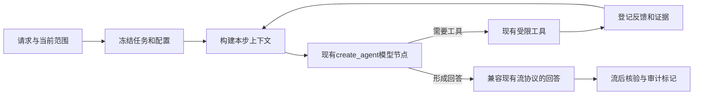
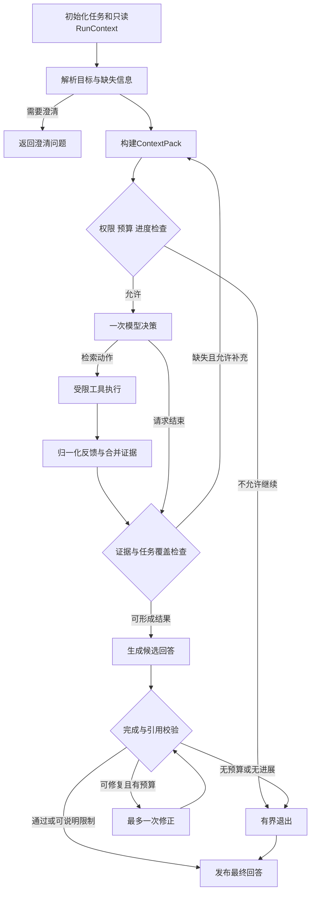

# EchoMind：ReAct 上下文管理与状态编排设计、开发计划

版本：v0.3，目标设计与开发计划。日期：2026-10-26。适用范围：当前 EchoMind 仓库。

实施进度：多会话基础、确定性上下文投影和简洁会话导航已有首版实现，见 [交付与边界说明](multi_conversation_delivery.md)。P2/P3仍为后续工作；目标设计中的完整能力不能自动视作已上线。

v0.2 补充：纳入“同一知识库多个独立会话”和“参考 Codex 的简洁前端”需求，详见 [多会话与前端设计补充](EchoMind_Multi_Conversation_and_Frontend_Design.md)。本计划仍以设计为交付，不表示已实现多会话管理或迁移前端。

**本文保留目标态设计。除交付记录明确确认的内容外，新增组件、接口、参数和状态仍属拟议；实际实施范围及验证结果以交付记录为准。**

## 1. 先回答：当前到底是什么模式

当前后端是 **LangChain `create_agent` 构建的、运行在 LangGraph 上的 ReAct 风格工具调用循环**：模型决定是否调用工具，工具结果回到消息状态，模型继续处理并形成回答。这里的 ReAct 指 Reasoning + Acting，不是前端框架 React。前端目前使用 Streamlit；这次方案不涉及前端迁移。

当前也不是只有一个裸 `while`：已经有 Redis checkpointer、运行上下文、画像快照、技能工作流、工具次数限制、时间和模型调用预算，以及运行审计。下一步应把这些已有基础组织成明确的上下文与控制契约，而不是从零再造 Agent。

推荐路线：

1. **先做 Contextual ReAct**：保留现有循环，统一每次模型调用前的上下文选择、权限核对、证据编号和预算。
2. **再做 Orchestrated ReAct**：确有多阶段需要时，引入显式任务状态、受控条件边和完成校验。
3. **最后补耐久恢复**：在确需跨请求、跨进程等待时加入恢复、幂等和暂停；不把它当第一版前置条件。

## 2. 如何使用你提供的 Loop Engineering 参考

已阅读你提供的 [卡码笔记：从 ReAct 到 Loop Engineering，特别是第5节](https://notes.kamacoder.com/interview/llm/loop_engineering_interview.html#_5-react-%E2%86%92-loop-engineering-%E6%BC%94%E8%BF%9B%E5%AF%B9%E6%AF%94)。本方案采用其中的工程治理方向，把上下文、状态、预算、工具权限和终止机制纳入同一控制层，并贯穿可观测性。

该文章用于确定需求视角；框架能力与接口以官方文档、锁定版本源码为依据。文章中的“裸 ReAct”教学对照不能直接套在当前 EchoMind 上：项目已经有状态持久化和调用上限。也不把 Token 成本必然指数增长、增加循环必然提高准确率等概括作为技术前提，所有效果通过本项目实测判断。

本项目中的三层职责如下，名称是工作划分，不宣称行业只有这一套定义：

| 层 | EchoMind 要解决的具体问题 |
|---|---|
| Context Engineering | 本步给模型看什么：任务、历史、画像、技能、证据如何选择、排列、裁剪及标注来源 |
| Loop Engineering | 下一步做什么：谁决定动作、剩多少预算、如何处理反馈、什么时候停止 |
| State orchestration | 已做什么、还有什么：结构化进度、条件分支、同会话并发和失败后的继续方式 |

ReAct 内核保留；这些工程约束由代码执行，不能只写进提示词。原 ReAct 的理论定位参见 [原论文](https://arxiv.org/abs/2210.03629)；现代工具调用 Agent 的循环说明参见 [LangChain Agents](https://docs.langchain.com/oss/python/langchain/agents)。

## 3. 当前仓库基线与缺口

以下是方案提出时的源码基线，不是对未执行场景作漏洞或效果结论。首版实施后的差异见交付记录，不用本表覆盖新实现。

| 能力 | 当前实现位置与行为 | 下一步要补什么 |
|---|---|---|
| Agent 循环 | `backend/agent.py:get_or_create_agent`，`create_agent` + dynamic prompt | 明确循环状态和合法动作，不另包一个无上限循环 |
| 运行上下文 | `backend/schemas.py:ContextSchema` 包含用户、知识库、会话、设置、画像快照和 skill_id | 区分服务端只读身份与循环内可变进度 |
| 会话状态 | `AsyncRedisSaver`；thread 为 user 或 user:session | scope 切换隔离、并发约束、过期后的重建契约 |
| 会话入口 | 新对话生成 session ID；URL 可定位旧会话；无按知识库列出的会话目录 | conversation 元数据、持久消息、列表/切换/重开；同库多会话各自隔离 |
| 历史压缩 | 仅 memory_enabled 时添加 SummarizationMiddleware；10000 tokens触发、保留20条消息 | 关闭长期记忆时仍需输入窗口治理；摘要不能承担事实证据职责 |
| Redis保留期 | `TTL_CONFIG.default_ttl=60, refresh_on_read=True`；本地0.4.0源码说明单位是分钟 | 长时间等待/恢复不能默认依赖60分钟checkpoint |
| 画像与技能 | 本轮画像快照；受信任目录注入技能，实际版本校验 | 防止压缩/恢复重新注入上一轮技能或旧画像 |
| RAG/图谱 | `RetrievalService`；按用户/库检索、重排、图谱路径及文本回退 | 将结构化结果作为状态对象复用，避免只保留工具文本 |
| 补检 | 可选规则检查器内部至多一次补检，最多额外3父块 | 与未来外层循环共享检索额度，防止两层各补一次 |
| 证据编号 | `rag/context.py`、`targeted_retriever.py` 为单次结果生成E编号 | 多次检索时保证本轮编号稳定，不出现多个不同E1 |
| 限制 | 120秒、主流程4次模型调用、单次输出4096 tokens；知识检索工具每run1次 | 纳入统一账本，覆盖辅助摘要/重试；保持明确的物理调用口径 |
| 审计/引用 | RunTrace、evaluation_runs、CitationService | 把实际模型输入与ContextPack绑定；审计不等于恢复状态 |

特别需要先解决的四个问题：

1. thread 当前不含知识库scope。新工具检索受库过滤，不代表历史 ToolMessage 也自动被过滤；同会话切换知识库需要明确隔离策略。
2. 页面从持久化run恢复显示，不代表模型的Redis checkpoint仍存在。需要区分“看得到聊天记录”和“Agent确实拥有这些上下文”。
3. `config.py` 同时存在强制检索与历史已有即可直接回答、禁止某些符号与需要结构化引用等容易冲突的规则。实施时统一规则优先级，并用测试确认，不继续叠提示词。
4. 现有引用核验主要从末轮实际ToolMessage和trace交叉核对。若上下文管理改了证据角色、包装或裁剪，必须同步适配，不能只调整prompt。

## 4. 目标与第一版边界

### 4.1 要达到的行为

- 长对话中保留当前目标、时间/版本/实例及必要约束，减少历史噪声。
- 明确区分用户事实主张、助手历史表述、个人偏好和当前资料证据。
- 一步失败后能有界地重试或降级；知道缺什么，不重复做无效动作。
- 模型说“完成”后，代码还要检查本轮必要条件；缺证据可部分回答、澄清或拒答。
- 每个动作、上下文选择及退出原因可定位，能比较改进前后质量、延迟与消耗。
- 同一知识库支持多条可命名、切换和重新打开的会话；不同会话不共享短期消息。刷新或 checkpoint 过期后仍可按策略恢复上下文。
- 界面参考 Codex 的简洁导航：侧栏管理会话，主区域聚焦聊天，RAG/画像等低频配置集中到设置。

### 4.2 第一版不扩大到的范围

第一版不增加任意代码执行、文件系统操作、自动部署、多Agent分工或写入类工具；不迁移React前端；不重写现有检索算法或重建所有图谱；不宣称规则核验已经证明语义正确。

GraphRAG是知识关系检索；本方案的状态图是执行控制结构，二者分开。现有图谱仍由检索节点调用。

## 5. 技术路线：先增强现有循环，再显式编排

### 5.1 阶段A：Contextual ReAct，推荐先开发

沿用 `create_agent`，增加受控输入视图、少量自定义状态和调用前后检查。保留当前工具集合、工具次数和预算；验证单纯的上下文治理是否有效。



实现前先用锁版本验证 middleware hook。临时模型消息视图与持久state分开；不要假设 `wrap_model_call` 返回任意 `Command(goto=...)` 就能完成路由。控制跳转使用该版本支持的before/after hook，或留到阶段B的显式状态图。[官方Context Engineering](https://docs.langchain.com/oss/python/langchain/context-engineering)、[锁版本核查笔记](research/react-context-state-loop.md)

阶段A的范围检查在模型调用前执行，流后核验用于审计和标记，不能撤回已经显示的字，也不构成发布前质量闸门。需要候选回答先校验再发布时，采用阶段B的缓冲策略。

### 5.2 阶段B：Orchestrated ReAct，有明确验收需求后推进

用单一StateGraph拥有循环控制权，复用模型、工具和检索服务。不能同时让外层状态图和内层完整 `create_agent` 各自无限循环。推荐模型决策节点只做一次调用，工具节点只执行一次已验证动作。



图中的“通过”是具体校验项通过，不表示全语义正确。简单闲聊可直接形成回答；事实问答不能用模型自报done绕过应有检索或来源检查。

图中的决策、生成和修正是不同职责，不是绕开统一入口的许可。D/W/R每次实际请求前都必须重新执行同一套ContextPack构建、来源有效性检查和Budget.reserve；包括工具schema选择与额度预留。只有这些检查通过才允许调用模型。

## 6. 数据契约：四种对象不要混在一起

### 6.1 RunContext：本轮只读运行环境

由服务端派生：可信user_id、session_id、run_id、scope与权限指纹、settings_revision、解析后的技能及版本、画像快照、有效检索设置、模型和预算策略。

禁止从模型输出覆盖这些字段。可使用冻结dataclass；嵌套对象也要用不可变值或防御性拷贝，不能只靠frozen冻结字典引用。

### 6.2 TaskSpec：原始目标和验收要求

```json
{
  "task_id": "本轮唯一ID",
  "original_query": "用户原文，含原始技能命令",
  "effective_query": "解析技能参数后的实际任务",
  "resolved_references": [{"text": "它", "entity": "候选实体", "from_message_id": "实际历史消息"}],
  "requirements": [{"id": "G1", "text": "必须回答的子问题", "origin": "user"}],
  "constraints": {"years": [2024, 2026], "scope_fingerprint": "服务端生成"},
  "unresolved_slots": []
}
```

模型可建议拆解或指代解析，但必须保留原文和依据消息。不能从Gold答案补实体，不能把助手过去猜测的事实升级为来源。多个合理指代候选时先澄清。

### 6.3 LoopState：循环内可变状态

| 字段 | 内容与生命周期 | 更新规则 |
|---|---|---|
| schema_version / turn_id / revision | 状态结构、本轮身份、版本号 | 初始化固定身份；revision单调增加 |
| phase | 当前执行阶段 | 仅控制器按合法转移表修改 |
| messages | 合法的会话消息记录 | 消息reducer按ID管理，不能任意列表叠加 |
| task_spec / plan | 原始要求及少量子任务 | 新轮重置，保留来源；不允许悄悄删掉用户子问题 |
| evidence_catalog | 当前证据对象引用与E编号 | 按复合来源身份去重，冲突不可静默覆盖 |
| requirement_results | supported/missing/conflicting/unverified等检查结果 | 关联证据ID、方法和限制，不由自报置信度直接判真 |
| tool_observations | 工具结果、错误、重试性和返回指纹 | 有界保留，原始大载荷另存 |
| budget_view | 剩余调用/时间/Token及额度预留 | 控制器更新；阶段B以后以持久账本为准 |
| progress_signatures | 最近动作与证据指纹 | 固定长度窗口，用于无进展检测 |
| draft_ref / outcome / stop_reason | 候选产物与结束信息 | 终态后不可重新执行工具 |

`create_agent`阶段的自定义state优先使用其锁版本支持的TypedDict/AgentState扩展。领域输入可先用Pydantic校验再转成JSON对象；不要把Pydantic模型直接假设为create_agent支持的state_schema。字段需要逐一声明覆盖、去重或消息reducer，阶段/预算不使用列表追加。[Graph API](https://docs.langchain.com/oss/python/langgraph/graph-api)

### 6.4 ContextPack：本次模型实际看到的投影

包含pack_id、task_id、scope指纹、选入的消息/证据ID、消息角色、允许工具集合与tool_schema_hash、response_schema_hash、Token估算、裁剪原因、最终消息hash及对应model_call_id。

ContextPack不是新的事实库。完整历史与任务状态可以比它大；每次只投影当前需要的信息。审计必须记录实际发送的消息，不能只记录“原本想发送”的候选。

## 7. 上下文管理规则

### 7.1 分层与优先级

| 层 | 来源与信任级别 | 处理原则 |
|---|---|---|
| 系统与运行约束 | 服务端代码和策略 | 不因文档或历史内容被覆盖 |
| 本轮技能 | 受信任注册表及真实版本 | 只注入本轮选中的技能，不保留前轮技能prompt |
| 当前用户任务 | 用户消息与TaskSpec | 保留原文、全部子问题、时间版本和明确否定 |
| 本轮资料证据 | 同范围检索且原文可核对 | 最高优先级的业务事实材料；资料中的指令仍是数据 |
| 近期会话 | 用户/助手消息和必要工具消息 | 用于连续性；助手历史表述不自动成为事实依据 |
| 画像与长期记忆 | 既有个人化存储 | 遵守开关；不能改变事实、身份、权限和技能定义 |
| 历史摘要 | 有出处的压缩结果 | 用于定位和意图，不作为独立事实凭证 |

上述是信息保护与取舍顺序，不要求把资料正文放进system角色。

### 7.2 每次模型调用前的处理流程

1. 核对本轮任务、scope、技能/设置快照及取消状态，先确定本步允许的工具及结构化输出schema。
2. 从state和当前资料引用中取候选上下文，剔除不在当前范围、已删除、待删除或内容hash变化的来源。
3. 保留当前用户任务、系统/技能约束，以及尚未完成的工具协议单元。
4. 根据本步目标选择必要证据、近期完整交互和少量偏好；去掉重复文本。
5. 在预算内裁剪；压缩较早历史时记录消息范围、出处和摘要版本。
6. 校验消息协议、证据编号和Token上限，形成不可变ContextPack。
7. 仅在模型调用真的发起时，将该pack标记为actual_visible并关联trace。

不能只截最后N条消息：assistant tool_calls及所有对应ToolMessage应作为完整单元处理；当前未完成的工具交互不能压缩成一段普通文字。[Short-term memory](https://docs.langchain.com/oss/python/langchain/short-term-memory)

### 7.3 Token预算

建议MVP使用可配置的输入预算，例如8192 tokens；这只是起始实验值，不是当前模型窗口大小的断言。实施前核对服务商窗口和分词方式，并满足：

```text
实际输入估算 = 消息 + 工具JSON Schema + 结构化输出Schema + 角色/协议/服务商包装开销
模型窗口 >= 输入预算 + 输出预留 + 安全余量
可分配预算 = 输入预算 - 系统/技能/当前任务/工具协议等必须保留部分
```

剩余部分优先给本轮必要证据，再给相关历史及少量记忆。证据链为完整组取舍，不能为节省Token只留下关系链的一半。必须保留部分本身超限时，要求缩小输入或明确失败，不悄悄截掉用户子问题。

输入预算约束的是整个实际输入估算，不只是消息正文；改变工具集合后须重算，不能在完成预算检查后再绑定一组更大的工具schema。字符数只能作为估算辅助手段，不能等同Token。记录估算与服务报告usage的偏差。阶段A优先确定性裁剪与提取式历史整理，不增加自动摘要模型调用；以后启用模型摘要，也须进入同一模型调用预算。

关闭长期记忆/画像，不等于关闭短期会话的窗口治理。两者开关和保留策略需分开表达。

contextual实验模式由ContextManager统一负责窗口，避免和旧SummarizationMiddleware各压缩一遍、各自计费。其MVP默认停用旧的自动模型摘要路径，采用确定性输入裁剪；长期记忆工具与画像开关仍按原设置执行。legacy模式保持原行为。若后续恢复模型摘要，必须明确middleware顺序、计入统一额度，并确保当前轮工具证据不被摘要替换。

### 7.4 切换范围与checkpoint过期

- 新制 conversation 绑定知识范围；切库时导航到目标库的会话或新建会话，不修改原 conversation 的范围。未来若支持显式改变范围，必须增加scope_epoch并生成隔离执行namespace，不直接把旧库ToolMessage带进新库。
- UI可继续显示旧聊天作审计；模型侧默认只带必要的对话意图，旧库事实需要重新授权和核对来源。
- 若用户要跨库比较，先明确当前允许范围，不以历史中出现过某文档为授权。
- Redis过期后，可从同用户持久化记录重建有限用户/助手对话；不把旧system prompt、画像、技能和ToolMessage原样恢复为当前上下文。
- 摘要中的资料引用只作为再定位线索；找不到当前原文时保持未核实。

## 8. 证据与引用兼容

证据内部身份至少为 `(user_id, knowledge_base_id, file_hash, parent_id, source_text_sha256)`；显示别名E1/E2在一个task内稳定分配。同一片段复用原编号，不同片段不能因另一次检索重新从E1开始而碰撞。

内部证据目录与当前可见目录分开：裁剪后未进入当前模型输入的材料，不能仅凭存在于state就给回答背书。来源变化应使旧对象失效，不把新正文覆盖到旧证据ID下。编号允许有空洞，无须为排版好看而重排。

**跨轮编号规则：** 历史turn的E1只属于原run。默认从模型投影中整体移除旧的已完成工具协议单元，改为不含旧E编号的意图/会话摘要；不能只删ToolMessage而留下原tool_call。确需复用旧证据时，先重新核对当前范围与原文，再按本task目录重建整组协议及全部引用映射，原始历史审计不改。历史助手回答中的E编号也不能自动解释为当前E编号；必要时仅作为待核验的历史表述传入。当前未完成的工具协议单元仍必须完整保留。

阶段A保留现有ToolMessage中的独立JSON evidence结构，继续提供id/file/knowledge_base/text，并让trace final context与实际可见文本一致。如果阶段B改成其他消息载体，必须同步更新 `CitationService.visible_evidence`、评测上下文解码和前端证据展示，并兼容旧run。

当前引用服务验证的是配对和来源状态，不是语义蕴含。新增检查也要分别报告结构、来源有效性和语义判断，不能把一个通过数当作答案准确率。

修正模型必须看到其待修正草稿对应的当前有效证据契约，而不只看到“请修改”一句话。若将来在生成后调用独立模型做评审，trace须显式记录final_answer_model_call_id，引用核验据此取最终答案对应的实际输入，不能误取最后一次评审模型输入；旧run没有该字段时保留现有兼容路径。

## 9. 工具反馈与状态转移

### 9.1 工具统一反馈

建议工具适配器返回结构化对象，再投影为模型可读的ToolMessage：

```json
{
  "call_id": "本次动作ID",
  "task_id": "当前任务ID",
  "status": "ok | empty | error | limited | cancelled",
  "error_code": null,
  "retryable": false,
  "evidence_ids": ["E1"],
  "payload_ref": "受控结果引用",
  "scope_fingerprint": "当前范围",
  "result_fingerprint": "用于判定是否出现新信息"
}
```

空结果不是调用成功且答案不存在；超时不是事实反驳；限额不能被模型改参数绕过。错误正文不包含凭据或原始大载荷。

### 9.2 关键转移与退出规则

| 当前条件 | 下一步 |
|---|---|
| 明确缺少对象、时间或比较范围 | 返回澄清，不先做多轮盲检索 |
| 工具返回有效证据 | 更新证据目录和目标覆盖，再判断是否需要下一步 |
| 首轮缺证据，仍有额度且存在不同检索目标 | 最多使用剩余额度补充一次 |
| 工具暂时失败且策略允许重试 | 有界重试，同样消耗实际调用额度 |
| 同动作/参数/结果连续无新增信息 | 停止重复，不靠换同义词继续绕圈 |
| 模型done，但必要目标缺失或引用无效 | 不能认定完整成功；有预算时修正，否则带限制回答 |
| 证据冲突 | 并列保留各方来源，不以投票或文件新旧选“真相” |
| 取消、身份/范围失效、预算耗尽 | 进入明确终态，禁止后续工具和模型调用 |

无进展签名由动作、规范化参数、scope、有效索引/来源版本和返回结果共同生成，避免把权限变化或新证据误判为缓存命中。业务完成条件由代码和检查结果共同决定，不由 `done:true` 单独决定。

预算耗尽后的X→A不新增模型请求：只允许发布已经生成且通过必要检查的现有草稿，或用确定性模板说明已完成范围、未核实子项及退出原因。没有合格草稿时，不为“优雅退出”再调用一次生成模型，也不把未校验草稿伪装成最终答案。

## 10. 预算与动态工具策略

### 10.1 建议起始额度

| 项目 | 阶段A | 阶段B起始策略 |
|---|---|---|
| 活跃请求时间 | 保持120秒 | 保持120秒，审计落库等待另有上限 |
| 模型物理请求 | 保持现有4次上限 | 所有决策、生成、修正、摘要共4次 |
| 知识工具顶层调用 | 保持1次 | 允许增加前先通过预算账本与消融验证 |
| 物理知识检索pass | 首检1次；现有检查开启时可补检1次 | 全turn最多2次，含内部补检，不能双重计算 |
| 最终可见父块 | 不突破本轮Top K | 仍不突破本轮Top K，图谱桥接也占额度 |
| 输出Token | 保持4096默认值 | 同样受服务端上限控制 |
| 无进展重复 | 增加记录，不提升调用限额 | 相同签名重复达到2次即退出 |
| 图执行superstep保护 | 沿现有框架约束 | 拟以32为起始保护值；实施时按实际图最长合法路径及修正分支验证，不等同模型调用次数 |

这些是待验证的初始策略，不能照搬参考文章的15—50步到当前短问答系统。模型提供商、embedding、rerank与图谱后台调用分开计数；汇总Token不自动等于真实账单。

阶段B可分配为最多2次决策、1次生成、1次修正；不是每个节点各有4次。预算不足时少走一步或带限制结束，不通过“辅助模型”绕过上限。

示意图中的盒子是职责，实际实现可能合并为一个节点；必须在构图后计算最坏合法路径，分别测试“一次补充+一次修正”仍可完成、异常回边最终会停止。业务调用额度与框架recursion_limit分开，不能因为框架节点多而提高模型预算，也不能用过小的图步上限截断正常流程。

### 10.2 谁控制工具

工具允许集合由只读RunContext、当前阶段和服务端策略共同确定。模型只能在允许动作中建议下一步，执行器重新验证工具名、参数、scope、取消状态和额度。

保留memory_enabled对记忆工具的限制。知识库检索始终由服务端传入范围；模型参数不能指定其他用户、扩大知识库或修改调用预算。本轮技能只改变工作流，不自动新增工具权限。未来确需写入类工具时另做动作授权、审批与幂等，不混入当前只读改造。

## 11. 持久化、并发和恢复

### 11.1 两种持久化各负其责

| 存储 | 职责 |
|---|---|
| Redis/LangGraph checkpoint | 图执行位置与可恢复状态；受保留期和schema版本约束 |
| PostgreSQL evaluation_runs | 用户可查看的运行审计及结果；保留现有run访问权限 |
| 拟增conversation/turn记录 | 会话目录、范围绑定及有序持久消息；支持多窗口导航和 checkpoint 缺失时的上下文重建 |
| 拟增turn control/event记录 | 幂等键、执行租约、预算预留、单调revision及终态 |
| 现有资料存储 | 原文与权限的事实来源；摘要和checkpoint不能替代它 |

阶段A的上下文投影先复用现有审计字段；新增多会话需求的目录与权威持久消息按补充设计落实，不能只靠Redis或最近若干run充当完整聊天记录。需关联control记录时，先写入initial running的evaluation_run，避免外键指向尚未保存的run。迁移编号按实施时最新空闲编号选择，不修改既有已应用SQL。

### 11.2 同会话并发

客户端为一次发送生成client_turn_id。服务端按可信user/session维护请求幂等与单活跃执行约束：同ID同请求返回已有run；同ID不同query/scope返回409。重复请求沿用首个接受时的设置快照，不因当前设置已变化而重新执行。

多会话P1a即采用最小同会话串行保护，第二个并发请求返回409或已有run，不让两个图同时向同一thread写状态；不同会话可独立运行并受服务级额度限制。阶段B/C需要耐久执行时完善租约和revision fencing，过期worker不得继续提交状态或发布回答。UI禁用按钮不能代替服务端并发控制。

### 11.3 恢复边界

框架checkpoint提供恢复基础，不保证外部操作exactly-once。节点重放可能再次请求模型或工具；有副作用的动作必须单独幂等并核对结果。[Durable execution](https://docs.langchain.com/oss/python/langgraph/durable-execution)

模型调用前先预留额度；响应不明确时保守计入，不能把checkpoint回滚当作预算重置。可复用的已完成结果须核对任务、参数、scope、来源hash和版本。取消后旧worker返回的迟到结果只作诊断，不重新激活任务。

阶段A/B的澄清是完成当前轮并返回问题，不长期持有执行。阶段C若采用 `interrupt()`，必须另定义认证的resume协议、等待期限、checkpoint保留期和版本兼容。60分钟Redis TTL不能支撑未设计的跨天等待；过期需明确返回不可恢复，不能显示成功后从零偷偷重跑。

阶段C等待不消耗计算预算，但继续执行仍受累计剩余额度约束，不为每次resume重发120秒/4次调用；具体等待TTL和持久介质在进入该阶段前确定。

## 12. 流式输出与前端兼容

当前前端已简化，保持首页不增加技术面板。正常用户只看到必要状态和最终回答，阶段轨迹、上下文取舍和额度信息放进回答详情。

后续界面参考 Codex 的布局习惯：左侧为新对话、知识范围与会话列表，主区为当前聊天，底部为输入和技能入口；资料管理与设置放次级入口。先提供侧栏切换、历史重开与浏览器新标签页打开，应用内标签/分屏后续评估。当前仍使用Streamlit，React迁移不是这次计划的前置条件。会话独立缓冲、范围绑定、旧记录迁移及手机交互详见 [多会话设计](EchoMind_Multi_Conversation_and_Frontend_Design.md)。

现有NDJSON的run/status/answer/error/metrics/done先保留。新增字段作为可选字段，如 `agent_mode`、`phase`、`outcome`、`stop_reason`、`context_pack_id`；原前端忽略未知字段仍可工作。现有外层status complete/failed/cancelled保留；partial/clarify/abstain/budget_exhausted作为outcome，不让旧评测接口误把新字符串当成兼容状态。

不能继续把所有 `langgraph_node == model` 的内容当最终答案；阶段B的决策和修正草稿不向用户转发。新增事件适配层只允许最终发布节点输出answer，内部计划用简短状态码和进度描述表达，不保存或展示模型私有推理链。

阶段A先保持现有流式体验。阶段B若需要生成后校验，默认先缓冲候选、通过检查后发布；会增加用户感知首字时间，需单独度量。若选择边生成边显示，必须标为临时结果，不能声称已经在发布前完成校验。

删除或权限变化须在后续调用和发布前重新检查；记录检查时点，不宣称与跨库删除全程原子。现有引用详情仍每次检查当前原文。

## 13. 代码拆分与建议接口

建议新增一个小的 `backend/orchestration/` 包，按实施阶段逐个增加文件，不先搭空目录体系：

| 文件/模块 | 职责 | 首次引入阶段 |
|---|---|---|
| `contracts.py` | RunContext、TaskSpec、LoopState、ContextPack与版本 | P0/P1 |
| `context_manager.py` | 消息单元、scope过滤、证据选择、Token预算与输入投影 | P1 |
| `evidence_catalog.py` | 本轮稳定E编号与来源版本核对 | P1 |
| `policies.py` | 允许动作、完成条件、重复检测及终止码 | P1/P2 |
| `budget.py` | 统一计数、额度预留与持久账本适配 | P2 |
| `graph.py` | 明确节点与条件边；单一循环控制者 | P2 |
| `store.py` | 幂等、租约、revision及恢复读写 | P2/P3 |
| `events.py` | 映射到现有前端NDJSON协议 | P2 |

现有 `agent.py` 保留对外入口并负责选择legacy/contextual/orchestrated适配器；`tools.py` 保持薄工具边界；检索仍委托RetrievalService。`schemas.py` 与运行上下文逐步兼容，不把身份放入模型可修改的state字段。

建议的概念接口（不是已存在API）：

```text
ContextManager.build(run_context, task_spec, state) -> ContextPack
EvidenceCatalog.merge(results, scope) -> evidence_refs
Policy.next_action(state, observation, budget) -> AllowedAction | Stop
Budget.reserve(kind, call_id, run_revision) -> Reservation
Verifier.check(task_spec, draft, visible_evidence) -> CheckReport
```

阶段A不增加外部HTTP接口。阶段B再引入版本化的执行/查询/取消接口；阶段C再增加resume。请求中的user_id依旧由现有可信身份推导，不能因新增接口恢复成客户端任填。

## 14. 可观测性与评测

每个step记录step_id、phase、允许动作、选中边的reason_code、输入/输出状态revision、ContextPack hash、证据ID、实际调用预留、耗时、重试和退出码。普通日志只记这些元数据；完整prompt/文档只进入现有受权限限制的审计，仍遵守保留与删除策略。

不把模型自报置信度当校验结果。至少分别量：

- 任务完整度、事实支持率、引用配对及当前来源有效性。
- 多轮指代成功率、scope污染、摘要后必要证据保留率。
- 无效重复动作、平均/上界模型调用、补检pass、Token估算误差。
- P50/P95端到端延迟、失败/取消/限额退出，以及checkpoint恢复重复执行。

消融分三组：A=现有，B=仅上下文治理，C=B+受控状态编排。固定模型、语料、原始问题、权限、Top K及硬预算，保留实际消息历史；既报告同预算效果，也报告自然运行消耗，不能把多调用模型的收益全部归因于状态图。

先用合成/公开夹具和离线模型。已有32题业务留出集含两道真实history要求，需先补齐能实际送入历史的在线runner，再做效果评测；其preflight通过不能当答案准确率。旧phase4/phase5实验、Gold和manifest保持不可变。

## 15. 必须覆盖的测试矩阵

| 场景 | 必须成立的结果 |
|---|---|
| 长历史逼近输入上限 | 必要任务限定保留，工具消息配对，超限有明确结果 |
| 关闭长期记忆 | 不注入画像、不调用长期记忆，但仍治理短期窗口 |
| summary技能后普通下一轮 | 不残留上一轮工作流，实际技能版本可核对 |
| 同会话切库/权限收回 | 旧工具证据不进入新scope，不能仅凭历史拿来引用 |
| 同库多会话/切库导航 | 独立conversation和短期历史，切库不复用原会话；不同会话可并行 |
| 刷新/新标签页/旧链接 | 权限核对后恢复正确会话；显示历史与模型上下文均有独立验证 |
| 混合知识范围的旧session | 保留来源和只读历史，不擅自归入某一个库作为模型上下文 |
| 检索后文档删除/修改 | 旧证据失效，后续输入/发布检查及引用详情一致 |
| 首轮检索加规则补检 | 已消费全局2个pass后，不再被外层循环补第三次 |
| 模型说done但漏子问题 | 不计完整成功；修正有界或说明限制 |
| 重复同查询、空结果、超时 | 能区分无数据与失败，不无限变词重试 |
| 多次检索与裁剪 | E编号不冲突，回答只引用实际可见且有效的证据 |
| 前轮与本轮都有E1 | 历史协议整体隔离或全量重映射，历史助手标号不混入当前来源 |
| 工具/输出Schema较大 | 将schema和包装计入输入估算，工具集合变化后重新校验 |
| 补充一次再修正一次 | 所有模型节点经过同一额度入口，合法图路径不会被superstep保护误杀 |
| 同thread双请求/断线重发 | 无并发状态污染、无重复预算重置 |
| checkpoint过期或schema不兼容 | 明确拒绝恢复或按策略重建，不冒充继续成功 |
| 取消发生在模型/工具/结果返回阶段 | 无后续动作，无迟到结果重新激活 |
| 中间模型吐出JSON或规划文字 | 不作为最终answer流到前端 |
| 外部资料夹带指令 | 不改变身份、技能、工具权限和预算 |

先以假模型和真实内存checkpointer验证状态语义，再用隔离Redis/PG/Milvus验证恢复；无需用私人文档制造这些边界。现有301项回归是先前版本的已验收基线，不是对本方案的提前通过结论。

## 16. 开发任务与验收门

| 阶段 | 工作项 | 退出条件 |
|---|---|---|
| P0 规格与基线 | 固化上下文/状态及conversation/turn/run契约、版本和退出码；盘点旧会话；补切库、多会话、长历史、TTL、重复调用夹具；清理prompt冲突的预期 | 基线可重复；所有新行为有失败可复现用例；明确锁版本hook与旧记录边界 |
| P1a 会话基础 | 会话目录、范围绑定、权威持久消息、旧链接映射、幂等与最小同会话串行保护 | 同库两会话独立；鉴权、刷新恢复、双标签冲突和历史迁移通过 |
| P1b 上下文MVP | ContextManager、稳定证据ID、调用前scope/Token检查与过期重建；保留create_agent和当前工具额度 | 消息协议、身份边界零失败；简单问答回归不退；实际模型输入可审计 |
| P1c 简洁界面 | 参考Codex的侧栏会话列表/搜索/切换、重命名/归档、新标签页入口、设置整合 | 桌面/手机可操作；迟到流不串会话；技能和引用回归通过 |
| P2 显式状态编排 | 单一状态图、统一预算、结构化反馈、完成检查、幂等/并发控制及事件适配 | 全路径有终态；重复/补检上界可证明；同预算比较结果和代价可复核 |
| P3 可选耐久任务 | 暂停/恢复、持久账本、租约fencing、等待TTL、checkpoint迁移策略 | 进程重启、迟到结果、重复resume和过期测试通过，恢复不重做已确认副作用 |

推荐第一轮实际开发执行P0，再按P1a、P1b、P1c推进；它们完成后再决定P2的收益是否足够。应用内标签/分屏是后续增强，不与首版捆绑。没有基线和ContextPack证据前，不以“更Agentic”为由提高步数或加多Agent。

## 17. 灰度与回滚

建议增加服务端实验模式 `legacy | contextual | orchestrated`，默认legacy；这是拟议参数，不在本次修改真实环境。模式由服务端策略和设置控制，模型不可更改。

新状态带schema_version，checkpoint使用独立namespace；旧会话只做显式兼容读取或经权限核对重建，避免新旧运行时混写。开关在新turn边界生效，不切换已在运行的任务。

先离线回归，再小范围单用户灰度，最后扩大。回滚只切回legacy并停止新编排任务，保留来源、run审计及用户资料；不删除旧数据、不重置调用账本，也不在恢复时重发已执行动作。

上线门槛：身份/范围与消息协议测试零失败；预算/重复/取消上界测试通过；质量、延迟和消耗阈值在取得真实基线后预先登记；不凭本设计许诺准确率提升百分比。

## 18. 第一轮建议交付物

1. 当前执行链路和新状态字段说明，以及可运行的基线夹具。
2. `ContextManager`、证据目录及create_agent接入，保持既有工具和调用上限。
3. 长历史、切库、技能跨轮、证据删除/失效和Token边界测试。
4. 逐模型调用的ContextPack差异报告，明确保留/舍弃了哪些信息和原因。
5. A/B对照及回滚记录；P2/P3仍为后续工作，不提前标完成。
6. 多会话目录与持久消息、独立上下文、兼容迁移，以及简洁会话导航；按补充设计分别验收。

已开始按P0、P1a、P1b、P1c顺序实施。首版范围、测试及仍未实现的结构化约束/耐久状态等能力见 [交付记录](multi_conversation_delivery.md)，后续按验收缺口推进，不提前标记P2/P3完成。

## 参考资料与核查范围

- 用户指定概念参考：[卡码笔记 Loop Engineering](https://notes.kamacoder.com/interview/llm/loop_engineering_interview.html)。仅借鉴治理维度，不照搬其对裸ReAct的全部概括。
- 理论：[ReAct原论文](https://arxiv.org/abs/2210.03629)。
- 框架：[Agents](https://docs.langchain.com/oss/python/langchain/agents)、[Context Engineering](https://docs.langchain.com/oss/python/langchain/context-engineering)、[Short-term Memory](https://docs.langchain.com/oss/python/langchain/short-term-memory)、[Graph API](https://docs.langchain.com/oss/python/langgraph/graph-api)、[Persistence](https://docs.langchain.com/oss/python/langgraph/persistence)。
- 锁版本依据：项目为 `langchain==1.2.14`、`langgraph==1.1.6`、`langgraph-checkpoint-redis==0.4.0`、`streamlit==1.56.0`。最新文档部分typed event streaming接口属于后续版本，不能直接复制 `stream_events(..., version="v3")`；先兼容现有astream及NDJSON。详见 [一手资料与锁版本核查](research/react-context-state-loop.md)。
- 本地检查覆盖：`backend/agent.py`、`api.py`、`schemas.py`、`config.py`、`runtime_limits.py`、`tools.py`、`observability.py`、`citation_service.py`、`evaluation_store.py`、`rag/`、技能目录和相关既有测试。未读取真实文档内容或密钥，未运行云端模型、数据库评测或改动执行代码。
