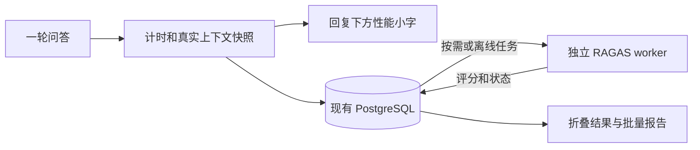

# EchoMind 评测框架方案

日期：2026-10-21。状态：第一版已按此方案实施，使用方法见 [评测使用说明](../evaluation/README.md)。下文保留设计口径；首版将 spans、contexts 与模型输入保存在 PostgreSQL JSONB 快照中，评测依赖独立安装并已通过真实小样本验证。更大规模的人工基准集及专用记忆 suite 仍需后续业务数据支持。

## 1. 目标与建议架构

采用两个独立但共享 run_id 的部分：

1. 每次问答自动采集性能数据，流式回答结束即展示耗时。
2. 使用记录下来的真实问题、上下文和回答异步运行质量评测。默认手动触发或离线批量评测，不默认每条对话调用裁判模型。

首期复用 FastAPI、LangChain/LangGraph、Streamlit 和 PostgreSQL；无需新增数据库、容器或托管平台。计时采集使用 Python 标准库 time.perf_counter_ns、ContextVar 与请求级收集器。模型调用使用 LangChain 回调或中间件跟踪。RAGAS 放在独立评测虚拟环境和工作进程中，避免改动当前严格锁定的业务依赖。OpenTelemetry / Langfuse / LangSmith 可以后续接入，首期不作为前置条件，也不默认上传对话到第三方追踪平台。

业务链路：Streamlit → FastAPI → Agent → 模型/知识库/记忆工具 → 回答与性能事件。

评测链路：同一次请求的数据快照 → PostgreSQL 评测任务 → 独立 RAGAS worker → PostgreSQL 结果 → 前端按需读取。



## 2. 当前代码的接入依据

- backend/agent.py：已有模型执行和 Redis 初始化日志，但“模型回答耗时”覆盖整个 Agent 循环，包含工具调用，不能当作纯生成时间。
- backend/knowledeg_base_manager.py：已有查询向量化计时；混合检索返回 list(set(parent_ids))，丢失排序。
- backend/tools.py：知识库工具包含召回、PostgreSQL 父块回查、重排序，目前没有分别保存结构化耗时及上下文来源。
- backend/postgresql_client.py：get_parents 仅 SELECT text，既没有返回 ID/文件来源，也不保证输入 rank 的顺序。
- backend/memory_manager.py：记忆检索包含向量化、多个类别的并行召回、降级及访问时间更新，不能简单相加。
- backend/agent.py 与 schemas.py：top_k 实际写死为 5；目前 thread_id 使用 user_id。实验前必须让有效参数和会话隔离真实生效。
- frontend/app.py：实际使用按行 JSON 流，现有类型是 answer/status/error；消息历史只保存角色、文本与时间。无需为了评测先迁移协议。

关键判断：本项目是按需调用工具的 Agent，不是每次都固定经过所有 RAG 阶段。计时必须允许不调用、重复调用和并行调用。

## 3. 性能数据与计时口径

| 展示项 | 测量边界 | 备注 |
| --- | --- | --- |
| 本轮服务端总耗时 | API 接收请求至构建结束事件 | 与首个 answer 字符、模型调用、存储分别记录边界 |
| 首字耗时 | API 接收请求至首次输出非空、用户可见 answer 片段 | status、工具参数和 reasoning 片段不算；另记客户端点击至首字，不能混为一谈 |
| 查询向量化 | 用户查询/工具查询调用 embedding 的全过程 | 知识库与记忆分开；记录每次重试和等待，父 span 包括重试总成本 |
| Milvus 召回 | hybrid_search/search 实际请求 | 记录原始候选数、返回数、混合/稠密降级与每次请求；不包含 embedding、父块和 rerank |
| 父块回查 | PostgreSQL get_parents 请求 | 保留 ID、文件与 rank，单独统计 |
| 重排序 | rerank 调用全过程 | 记录有效排序、失败降级、次数与等待；不可把降级写成成功 |
| 模型决策/最终生成 | 每次模型请求开始至结束 | 记录所有模型调用，再标出产出最终答案的调用。模型 API 客户端观测耗时不等于供应商内部纯计算时间 |
| 画像/会话/记忆 | 画像查询、Redis 检查点、记忆工具及子调用 | 与知识库检索分开 |
| 存储与评测排队 | 消息/trace 落库、评测任务持久化 | 位于回答结束后的步骤另记，不伪装成已完成的回答前耗时 |

计时要求：

- 使用单调时钟测持续时间，UTC 时间戳仅供关联；不使用 time.time 差值作为精确性能口径。
- 每次请求一个 run_id，每个调用一个 span_id/parent_span_id，包含 offset_ms、duration_ms、source、status、retry_count、fallback 和数量等字段。ContextVar 只传请求上下文，不使用全局可变计时器；异步任务、线程和回调都验证上下文传播。
- 同一次请求可能有多个 LLM 调用。不要用“总耗时减检索耗时”估算生成时间；父子 span 和并行分支不能重复相加。详情提供时间线，汇总显示耗时及调用次数。
- 当前改写藏在 Agent 生成工具参数中，首期归入模型决策。只有日后拆成明确改写节点，才单独显示“查询改写时间”。
- 未执行阶段显示“未调用”，失败显示失败及已消耗时间；不使用 0 秒掩盖缺失。出错、取消、客户端断开也关闭 span，记录 incomplete/cancelled。
- 记录模型、top_k、rerank、分块版本、知识库快照、有效参数、缓存命中、请求状态；token usage 仅在供应商提供时记录，缺失为 null。
- 上传文档的解析、分块、批量 embedding 和入库另设 ingestion trace，不能混入某次提问的查询向量化。
- 总览统计 P50/P95、样本数、错误率、空召回率、重试与降级率。冷启动/热请求、不同模型和负载分组比较，不能用几个样本承诺稳定 P95。

## 4. 回复下方如何呈现

示意，以下数字不是实测：

> 总耗时 5.4s · 首字 3.1s · 性能详情 ▸

使用小号次要文字，与回答正文隔开；保留可读对比度，不占用模型正文。展开后显示查询向量化、Milvus 召回、父块读取、rerank、模型决策与生成，以及重试/降级信息。并行任务使用时间线解释，避免给人各项应当相加等于总时间的错觉。

质量评测另设折叠项“评测本条 / 评测结果”，状态为未评测、排队、评测中、完成、失败或不适用；完成后显示各项分数及解释，不默认合成总分。

流式消息沿用按行 JSON，新增 version、run_id、metrics、done 等结构化事件；保留现有 answer/status/error。示例：

```json
{"type":"metrics","version":1,"run_id":"…","timings":{"server_total_ms":5400,"ttft_ms":3100},"status":"complete"}
```

前端将 run_id/timings 保存到该条 assistant 消息，重新渲染不丢失；浏览器刷新后可用 run_id 从数据库恢复。后续评测分数通过独立接口查询，不保持回答流长连接等待评分。结构化事件不送回模型提示词。

## 5. 上下文快照：评测正确性的基础

每次记录以下三种数据，不能只在评测时重新检索：

1. 用户原问题与实际检索 query，含 Agent 对查询的改写。
2. 原始召回、去重父块、rerank 后候选：保留 rank、child_id/parent_id、知识库、文件 hash、来源位置、原始分数及分数类型。
3. 最终确实传给模型的、有序上下文文本快照，包括截断后的内容；同时记录最终回答及被使用的历史/画像/记忆范围。

改造为结构化 RetrievedContext，至少包含 source_type、source_id、parent_id、knowledge_base_id、file_hash、text、rank、score、stage、included_in_prompt。优先保留有序去重；SQL 查询显式恢复输入顺序；rerank 按返回 index 对齐，不能仅按文本匹配（重复内容会错位）。

知识库和长期记忆分源保存。知识库检索质量用知识库上下文评；记忆事实单独评测。对混合回答，faithfulness 的支持证据必须覆盖实际可见的知识库、记忆、历史等，且解释来源；只对知识库评测时，使用关闭记忆的独立实验，避免把合法记忆回答判成知识库幻觉。

当前 parent_id 是入库时生成的 UUID。首期锁定语料/分块/向量集合快照，标注跟随这一版 ID；重新入库后不能直接沿用旧标注。后续可增加“文件 hash + 来源位置 + 分块版本 + 内容 hash”的稳定来源 ID，维护到运行时 UUID 的映射。

## 6. 质量指标与所需标注

具体类名与依赖以独立研究文件中的官方来源、最终锁定版本为准。

| 指标 | 回答什么问题 | 数据要求/边界 |
| --- | --- | --- |
| Context Precision（检索上下文精度） | 相关证据是否排在前面、无关内容是否多 | 使用有参考答案版本作正式评测；无参考答案版本可用实际 response 作代理，但必须标为无参考代理，不能替代真实标注 |
| Context Recall（上下文召回） | 标准答案里的事实是否得到检索内容覆盖 | 需要 reference；缺少标准答案不展示真实召回率 |
| Faithfulness（忠实度） | 回答中的事实是否被给定证据支持 | response + 实际上下文；证据本身错误时仍可能高分，不代表客观正确 |
| Response Relevancy（回答相关性） | 是否回应用户原始问题 | user_input + response，具体版本可能需要裁判 LLM 与 embedding；不能以改写 query 替代用户问题 |
| Answer Correctness / Factual Correctness（答案正确性/事实正确性） | 与标准答案相比是否正确、事实是否完整 | reference + response，按所选官方实现补充 user_input/embedding；二者算法不同，必须记录具体 metric_id，不能用一个名称掩盖版本差异 |
| Precision@K / Recall@K（ID 标注） | 前 K 个结果中相关比例、标注相关证据覆盖比例 | 需要人工标注的相关 source IDs；自行确定性计算，和 RAGAS 裁判式 Context Precision/Recall 分开报告 |

其中“准确率”需要区分检索精度和答案正确性。RAGAS 的排序式 Context Precision 与简单 Precision@K 不同；Context Recall 更接近参考答案事实覆盖，不等同于全库所有相关文档的完备召回。

确定性公式：Precision@K = 前 K 个实际返回结果的相关命中数 / K；少于 K 个时明确采用空位按未命中计，并同时报告实际返回数。Recall@K = 前 K 个结果命中的标注相关 ID 数 / 全部标注相关 ID 数。统一父块/子块粒度并去重；无相关 ID 标注时结果为 N/A，而不是除零或 1。

这些指标是特定定义、标注与裁判下的分数，不是“答案正确的概率”。不先规定 0.8 等通用合格线，先建立基线和人工核对，再确定用途对应的阈值。

答案正确性首选 FactualCorrectness(mode="f1")；AnswerCorrectness 作为可选的事实与语义组合指标，不能把两者当作同一个分数。当前官方推荐使用 ragas.metrics.collections、llm_factory 和异步 metric.ascore；实施时锁定已验证发布版本，不混用旧版 LangChain wrapper 与新接口。评测 embedding 单独适配，不能默认现有原生 DashScope embedding 对象可直接传入现代 OpenAIEmbeddings。

## 7. 按需评测与离线实验

在线：回答结束保存快照。用户点击“评测本条”或管理员配置采样，才创建评测任务。缺 reference 时只运行适用指标；Context Recall/答案正确性明确显示缺标注。不每次回答都默认付费评测。并发、token 预算、样本数、模型与指标在批量运行前可见。

离线：建议先整理约 30–50 条真实文档问题，包含改写问法、多证据问题和不可回答问题；每条提供问题、参考答案、证据 ID/文本、answerable 标记、预期检索行为及语料快照。人工审核参考答案，不把系统自己的回答当标准答案。开发集调参数，留出固定测试集作最终比较。

数据集行结构草案（人工填写实际问题和依据，示意不充当真值）：

```json
{"case_id":"kb-001","user_input":"问题","reference":"审核后的标准答案","reference_context_ids":["固定语料版本中的证据ID"],"answerable":true,"requires_retrieval":true,"corpus_version":"snapshot-001"}
```

Runner 应复用同一业务检索/生成代码与 LangGraph 执行上下文，不能另写一套简化 RAG 代替生产链路。当前 get_stream_writer 依赖图运行上下文，独立调用 manager 时需要相同上下文或可选事件发射器。

先评检索再评端到端：对相同样本比较重排开关、hybrid/稠密、top_k 等。必须把当前写死的 top_k 变成真正向下传递的配置，记录生效值、候选数量和最终上下文数量。不同配置配对比较，导出逐样本分数、失败原因、均值/分布与耗时。

单轮 KB 实验禁用个人画像/历史记忆及会话复用；引入 session_id，以 run/样本隔离 checkpoint，避免目前 user_id 固定线程污染结果。评测使用独立身份/测试知识库，关闭记忆写入与后台压缩对实验身份的影响。多轮和记忆能力另建有固定历史与状态重置规则的 suite。

适用性与失败处理：纯闲聊且不要求检索可标 N/A；本来应该检索而 Agent 没调工具，必须记录 routing_failure，按有标注规则计算召回失败，不能悄悄剔除。应回答但空召回/生成失败的样本保留在分母和失败率中。不可回答题用拒答正确率另评，不能强套 reference 事实召回。

裁判优先使用兼容配置的 DashScope 模型，和业务生成模型配置分开；接入时验证结构化输出、embedding 接口与锁定 RAGAS 版本，不假设所有 OpenAI 兼容端点完全等价。RAGAS 新旧 API 不混用。固定裁判模型、提示词、metric 版本和参数；低 temperature 也不保证完全可复现，抽样重复评分并与人工核对。

## 8. 持久化与工作进程

建议核心表：

- chat_runs：run_id、user/session/message 关联、开始/完成时间、状态、问题/回答快照、timings、有效配置、语料版本。
- trace_spans：run_id/span_id/parent_span_id、开始偏移、持续时间、种类、来源、状态和属性。
- retrieval_contexts：run_id、tool_call/model_call 关联、stage、source IDs、有序文本快照与分数类型；知识库/记忆分源。
- evaluation_jobs：run_id 或 dataset_sample_id、指标集、裁判配置、reference、queued/running 状态、租约、尝试次数、预算。
- evaluation_results：job/run、metric_id/version、value、解释、失败原因、不适用原因、裁判模型/提示词版本、tokens、评测耗时、评测时间。

评测进程使用现有 PostgreSQL 任务表取任务，短事务锁定/认领后释放，再调用模型；设置并发、超时、退避重试和租约恢复。以 run/数据集版本 + 指标版本 + 裁判配置指纹作为幂等键，防止前端刷新造成重复计费。单进程也持久化任务，不能仅用 asyncio.create_task 或 FastAPI BackgroundTasks 当作可靠队列。

run 快照和自动评测任务采用同一事务或可靠 outbox；评分失败不改变答案成功状态，也不阻塞回答。存储不可用时至少允许正常返回回答，清晰记录 telemetry 不完整；不可把未保存的数据冒充可恢复结果。

上下文包含私有文档/记忆，默认本地持久化，限制读取到所属 user/session，设置保留期与清除/导出机制。API 密钥不写入 trace；对裁判模型的发送属于额外外部调用，配置中清楚说明。只按需保存裁判结论/证据，避免收集不必要的内部推理文本。

## 9. 文件和接口建议

计划新增（尚未实现）：

- backend/observability/：trace context、计时 span、结构化事件与请求聚合。
- backend/evaluation/：样本适配、任务写入和结果查询；业务环境不导入 ragas。
- evaluation/：独立依赖锁文件、worker、RAGAS adapter、数据集与 report runner。
- backend/migrations/：trace/评测任务及结果表。
- frontend/app.py：assistant 消息元数据、小字 footer、折叠详情和按需评测按钮。

接口草案：GET /runs/{run_id}；POST /runs/{run_id}/evaluations；GET /evaluations/{job_id}；离线批处理 CLI。必须校验 run 与调用者范围，返回 202 job_id，禁止客户端任意指定付费模型/无限指标组合。

## 10. 实施顺序与验收

第一阶段：定义 span/事件与 run_id；接入全链路耗时、前端 footer、错误与取消处理、PG 持久化。通过并发两请求隔离、并行时间不重复相加、无检索显示未调用、重试耗时、旧流式客户端兼容与 rerun 后数据不丢失等检查。采集不触发额外模型请求；测量 instrumentation 开销。

第二阶段：补全有序来源 ID、候选和模型可见上下文快照；修正 top_k 有效配置及会话隔离；准备人工审核小数据集。验证 rerank 后上下文与真正传给模型的文本和顺序一致，防止把候选当最终证据。

第三阶段：独立评测环境与 worker，先接 Faithfulness / Response Relevancy / Context Precision，再接带 reference 的 Recall 与答案正确性；补 Precision@K / Recall@K。用缺标注、纯闲聊、漏调检索、空结果、裁判失败、重启与重复提交等样本验证状态。离线报告导出逐题明细和可配对比较的汇总。

后续可选：记忆/多轮专用 suite、批量实验页面、真实并发负载测试、OpenTelemetry 导出。首版不要求一次引入这些设施。

不在设计阶段安装 RAGAS、拉取镜像或执行付费评测。开始实施前需按用户要求提前说明新增 Python 依赖及下载用途；预计不需要新容器镜像。判断模型与标准答案数据集的具体选择留到小样本接入时明确。

## 官方资料

RAGAS 指标定义、输入与版本路线见配套 [RAGAS 官方资料核对](research/ragas-metrics.md)。本方案的代码事实来自当前仓库；架构、排队策略、UI 和实施顺序为本项目的设计建议。
