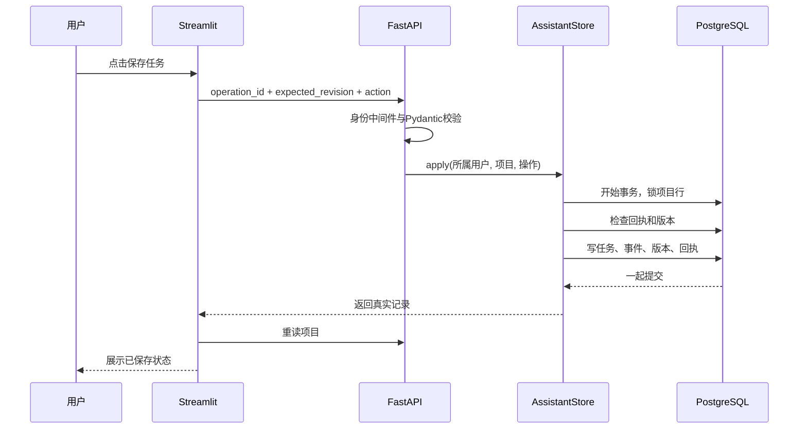

# 从问答系统到个人助手：跟着 EchoMind 源码学习

阅读日期：2026-10-27；2026-10-28补充主动提醒。配套方案：[产品与技术路线](personal-assistant-plan.md)；第一阶段完成情况：[交付与验收](personal-assistant-delivery.md)。本文针对当前 Python 实现，示例中的项目和任务ID需要替换为自己的实际值。

## 先理解一个完整场景

你创建“完成个人助手第一版”项目，添加“整理实验结果，预计30分钟”，再记录“决定先完成工作台，暂缓外部日历”。关掉页面、重新打开，任务和决定仍在。新开这个项目的聊天，助手读取同一份业务状态，知道接下来要做什么。

这里有三种不同的信息：

| 信息 | 示例 | 保存方式 |
|---|---|---|
| 对话 | “为什么先做工作台？” | 原有会话与轮次表 |
| 项目事实状态 | 有一项任务待开始；当前决定是先完成工作台 | 新增项目、任务、笔记表 |
| 助手建议 | “建议增加阅读SSE和实现流式输出两项任务” | 候选表；采纳后才进入任务表 |

理解这一区别，就理解了个人助手的骨架。模型擅长理解和表达，数据库负责保存“实际记录了什么”。

如果每天投入约一小时，可以按五次阅读完成：

| 次序 | 阅读 | 动手验证 |
|---|---|---|
| 第1次 | 第1–3节，模型与请求链路 | 创建项目和任务，找到对应API与表 |
| 第2次 | 第4–5节，事务、重试与来源 | 重复操作、更正记录，观察事件与版本 |
| 第3次 | 第6–7节，项目上下文和工具 | 对照离线Agent测试，区分候选与正式任务 |
| 第4次 | 第8–9节，恢复、复盘和界面 | 完成后重开任务，生成复盘并刷新页面 |
| 第5次 | 第10节，验证方法 | 运行检查，解释并发冲突和断线重试的原因 |

每次先自己预测结果，再运行或阅读测试核对；暂时不需要先掌握所有框架内部实现。

## 1. 先看领域模型：我们究竟管理什么

打开 `backend/assistant/models.py`。不必先读框架源码，先看 `CreateProject`、`TaskDraft`、`AddTask`、`UpdateTask`、`AddNote`。

任务用明确字段表达：标题、类型、优先级、预计分钟数、截止日期、状态。`Literal` 限制可用状态，`Field` 限制长度和范围，`extra='forbid'` 拒绝多余字段。这样模型或浏览器传入拼错的字段时，会得到明确错误，而不是悄悄丢失。

```python
{"kind": "add_task", "title": "整理实验结果", "estimated_minutes": 30}
```

`Action` 是带 `kind` 区分字段的联合类型。它的含义是“只能是已定义的一种操作”。表单、明确命令和助手候选最终都进入同一套模型，减少三条路径规则不一致的问题。

`UpdateTask` 还有跨字段检查：完成任务必须填写完成依据，标记受阻必须填写阻碍。注意，这些是输入规则，不是已经证明任务真实完成。界面和复盘将依据称作“用户报告”。

练习：找到预计耗时的范围。如果传入负数、字符串或布尔值，会发生什么？然后看对应测试，而不是凭感觉判断。

## 2. 为什么任务存在 PostgreSQL，而不是向量库

打开 `backend/migrations/010_personal_assistant.sql`。先认识以下表：

| 表 | 回答的问题 |
|---|---|
| assistant_projects | 项目是什么、属于谁、目标是什么、当前版本多少 |
| assistant_tasks | 有什么任务，目前是什么状态 |
| assistant_notes | 用户记录过哪些进展、决定、阻碍和学习内容 |
| assistant_resources | 哪些文档或链接与项目有关 |
| assistant_project_conversations | 哪些聊天属于这个项目 |
| assistant_proposals | 助手提出了什么，用户是否采纳 |
| assistant_events | 每次正式修改发生了什么、来源是什么 |
| assistant_operations | 某个操作是否已经执行，以及执行结果 |

向量检索回答“哪些文字可能与这个问题有关”，任务管理需要回答“这条指定任务现在到底是什么状态”。后者不能依赖相似度和Top K。原有 Milvus 仍用于资料发现，Redis仍用于执行过程，职责没有混在一起。

迁移使用 `CREATE TABLE IF NOT EXISTS`，由应用启动初始化。它是增量建表，不把旧聊天批量转换为项目事实。历史聊天含推测和讨论，不能自动全部变成确定任务。

## 3. 沿着一次请求读代码

打开 `frontend/assistant_ui.py`，找到 `_action` 和 `_send`，然后打开 `backend/assistant_api.py` 的 `apply_action`。



API层负责把HTTP请求转成调用和错误码，业务层负责规则与事务。`422` 表示输入不符合模型，`404` 表示对象不存在或不可访问，`409` 表示版本或操作冲突。

身份继续由 `backend/auth.py` 的现有中间件确定；传一个别人的user_id不能获得别人的项目。业务查询还会核对项目、任务和资料所属范围。字段合法与有权限是两回事。

`async def` 表示函数可以在等待数据库或网络时让出执行；`await` 等待结果。它不会自动让CPU计算并行，也不会自动替你启动后台任务。

## 4. 最重要的工程知识：事务、版本和幂等

打开 `backend/assistant/store.py`，重点顺序是 `apply` → `_receipt` → `_mutate`。

### 事务：几个写操作必须一起成功

一次新增任务会写任务表、项目版本、事件和回执。如果写事件失败，前面的任务写入也要撤销。否则页面可能显示任务存在，复盘却完全没有来源。`async with conn.transaction()` 提供全部提交或全部回滚的边界。

### 项目版本：阻止旧页面覆盖新进度

你和另一个浏览器都看到版本5；第一个保存成功，版本变6；第二个仍带expected_revision=5，后端返回409。

实现先 `SELECT ... FOR UPDATE` 锁住所属项目行，再核对revision并修改。同一项目的正式变更串行提交。锁只覆盖短数据库事务，不跨模型调用。所有任务共用项目revision，是第一版便于理解的保守选择；代价是两个独立任务也可能触发版本冲突，后续可以按实际并发需求改细粒度版本。

### 幂等：连接中断后安全重试

设想数据库已经保存成功，但响应没有送回。浏览器不能确定成功与否。如果重新生成操作ID再提交，会重复创建任务。

本实现给每次业务操作一个 `operation_id`。同一个用户、同一个ID、同一份内容再次到达时，返回原回执；同一个ID换了内容，返回冲突。操作指纹还绑定项目、版本和来源，防止混用。

为什么先检查回执、再比较版本？因为第一次成功后版本已经增加；重试仍带旧版本，但应当拿到原成功结果。

前端 `_attempt` 遇到网络异常或服务端不确定错误时保留原请求，并提供“重试原操作并核对”。这比在浏览器里先乐观插入一条任务更容易解释和验证。

幂等保障覆盖的是本地业务提交。未来接邮件或日历时，外部调用和本地事务不在同一个数据库里，需要另做outbox、服务端幂等键或补偿设计，不能直接宣称外部执行恰好一次。

## 5. 个人记忆如何保留来源并允许更正

决定、进展、阻碍和学习笔记放在同一类结构化记录里，以note_kind区分。表单保存来源为user_form，明确命令保存为user_command，采纳的助手建议保存为assistant_proposal，并保留真实来源轮次。

更正记录使用 `supersedes_note_id`：新增一条正确记录，并将旧条目标记为被替代。当前项目快照只读取未被替代的记录；旧内容仍保留在事件历史中。跨项目更正、类型不同或重复更正会被拒绝。

这不是通用的自动矛盾推理器。第一版采用明确更正关系，避免把“最新说法”或“更相似的文字”自动当成真相。

## 6. 新聊天为什么还能接上工作

打开 `backend/conversations_api.py`，找到新增的project_id、项目快照和 `send_turn`；再看 `backend/assistant/store.py` 的 `create_conversation` 与 `for_conversation`。

新建项目聊天时，服务端确认项目属于当前用户、资料范围相同、项目未归档，然后把会话ID与项目ID关联起来。旧的普通聊天不传project_id，仍按原流程创建。

发送新一轮时，服务端重新读取项目状态，构建 `project_snapshot`，记录到本轮执行配置。`backend/agent.py` 将它放入运行时上下文与系统提示中。下一次不同聊天也会根据同一个项目ID读取最新记录，因此不依赖回到某个唯一旧聊天。

`backend/assistant/service.py` 的 `project_snapshot` 对任务、笔记和单字段长度设上限，并给出省略数量。超出摘要范围不等于不存在；只读工具允许分页读取指定类别。完整项目状态不会无限塞进每轮模型输入。

重要区别：LangGraph检查点保存执行图/会话的状态；项目表保存跨会话业务状态。个人助手需要后者。将项目内容当作数据处理，避免把笔记里的“忽略规则”等句子提升为系统命令。

## 7. 模型究竟怎样“做事”

打开 `backend/assistant/tools.py`。这里新增两个工具：

- `get_project_workspace`：读取服务端绑定项目的最新摘要或分页记录。
- `propose_project_action`：校验并持久化一项候选动作，不直接改正式任务。

`ToolRuntime[ContextSchema]` 是框架注入的运行时上下文。user_id、绑定项目和真实轮次不由模型作为普通参数填写。工具schema只让模型描述业务操作，数据库层再次验证目标任务、文档和来源。

模型生成调用 → LangChain执行Python工具 → 工具访问数据库 → 工具结果返回模型 → 模型解释结果。工具返回not_saved，就没有保存成功；生成一句“已经记录”不能代替数据库回执。

一份多任务计划用 `add_tasks` 作为一个原子候选，最多10项。用户采纳后整批任务在一个事务内创建，避免采纳第一项后其他候选因版本变化失效。独立旧候选仍会因为基线版本过期而拒绝执行。

工具调用的持久键由真实turn_id和tool_call_id派生，相同调用重试不会重复创建候选。候选创建时还检查原轮次租约，超时后的迟到执行不能继续落候选。

原有摘要、审阅等资料技能保持只组织回答的契约：项目上下文可以参与理解，但候选写入工具不会在这些技能中开放。普通项目对话才有候选工具。

自由聊天仍使用项目已配置的模型。工作台表单、明确命令、恢复建议和复盘本身不调用模型。测试使用离线模型替身，验证工具调用和数据流；不能将这些测试当作真实模型的规划质量成绩。

## 8. 恢复建议和复盘为什么先用规则

阅读 `resume_workspace`。它按临近截止、优先级和进行中状态排序，在用户给定分钟数内挑选最多三项。预计耗时来自用户输入，不是预测模型；没有预计耗时就先分配一个限定时间的启动块；整项太大时只建议推进子步骤。

这是容易检查的基线。后续可以与模型计划对照，观察用户采纳和修改次数，再判断复杂策略是否值得。

阅读 `build_review`。它查看时间范围内的真实事件，区分新增任务、完成事件、重新打开和笔记。一个任务完成后又重开，复盘会同时保留完成报告和当前重开状态；不会因为它现在未完成，就抹掉曾经发生的变更。

报告附事件编号与来源。超过读取上限会标明截断，不声称完整覆盖。复盘API在同一个一致性快照里读取项目和事件，避免并发修改导致两者版本混杂。

## 9. Streamlit的刷新与你熟悉的前端有什么不同

Streamlit组件交互通常使Python脚本从头执行。session_state保留同一浏览器连接内的交互状态，但刷新或断线可能重建它，所以任务不能只存在session_state里。

`frontend/assistant_ui.py` 的 `_send` 只在提交事件中写入；每次显示读取服务端状态。成功后rerun刷新界面；失败时保留表单内容。操作表单有局部版本key，成功只清理相应表单。

工作台与知识对话通过工作区选择切换。项目会话显示返回项目入口，打开项目聊天会保存关联关系，重载后可继续访问。身份切换沿用已有清理策略，不复用上一个人的项目缓存。

## 10. 如何验证自己真的理解了

先运行应用的统一检查命令（连接本地数据库时使用隔离随机schema，绝不拿真实项目做删改测试）：

```powershell
.\.venv\Scripts\python.exe scripts/run_checks.py --integration
```

重点阅读 `backend/tests/test_personal_assistant.py`、`backend/tests/test_personal_assistant_agent.py` 和 `frontend/tests/test_personal_assistant_ui.py`。完整实际命令与通过数量见交付文档。

建议亲手完成五个实验：

1. 新增任务后刷新页面，再开另一个项目聊天，检查任务是否仍存在。
2. 在两个窗口打开同一项目，先后修改，观察第二个窗口如何处理409。
3. 用同一个operation_id重试请求，检查是否只产生一条任务和一次变更。
4. 让助手保存计划候选，先查看正式任务数量，再采纳，观察前后差异。
5. 完成一项任务后重新打开，生成复盘，检查完成事件与当前状态是否都被保留。

做完后，应能解释：一次模型回答、一个已持久化候选、一次用户采纳和一个实际完成的任务，分别由什么记录证明。

## 11. 第二阶段学习：持久提醒与主动跟进

本轮已经实现单次站内提醒、收件箱、已读、取消和稍后提醒。详读 [提醒技术路线与源码学习](personal-assistant-reminders.md)，建议再投入一次约一小时的阅读：先区分提醒与通知，再看调度器事务，最后做停机补发实验。

关键源码是 `backend/assistant/reminders.py`、`backend/migrations/011_assistant_reminders.sql` 和 `frontend/reminders_ui.py`。后台按数据库时间扫描，通知插入与提醒状态更新一起提交；前端局部刷新读取收件箱。提醒有独立版本，投递不会影响任务或模型候选的项目版本。

本轮边界是站内通知：服务停止期间不能实时送达，重启后补发；未连接外部日历，也未发送邮件或系统推送。后续若接入这些渠道，需要在数据库事务之外另行处理发送回执和重试，不能直接套用站内“同一轮通知只保存一条”的保证。

官方资料与项目推导的区别详见[技术基础核对](research/personal-assistant-foundations.md)。
