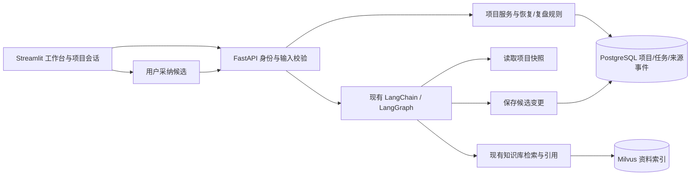

# EchoMind 工作与学习个人助手：产品与技术实施方案

日期：2026-10-27；目标用户：以项目推进、资料整理、计划和复盘为主要需求的个人。本文定义路线；实际完成状态以 `personal-assistant-delivery.md` 为准，不将规划当作已交付功能。

2026-10-28续建：A–D之后的阶段E已推进到持久站内提醒，详见[提醒技术路线与学习](personal-assistant-reminders.md)和[第二阶段验收](personal-assistant-reminders-delivery.md)。下文“第一版”指A–D的原始范围。

## 1. 产品目标和第一版验收

核心体验：隔天重新打开，助手能指出上次做到哪里、依据什么记录、还有哪些阻碍，并结合今天可用时间给出下一步。以自己的 EchoMind 开发项目作为首个使用场景，但演示数据单独标记，不混入真实工作成绩。

第一版必须走通：创建项目 → 添加任务与资料 → 记录进展、决定和学习笔记 → 更新任务 → 新开项目会话读取相同项目状态 → 按可用时间恢复工作 → 根据实际变更生成复盘并导出。

工作台不要求先上传知识库。普通知识问答入口继续保留；项目可以绑定一个自有知识库，默认范围为用户有权访问的全部知识库。项目绑定范围在第一版创建后固定，避免历史会话的权限和来源随意漂移。

## 2. 用户流程

### 项目与任务

项目包含目标、资料范围、状态、修订号和时间。任务包括工作/学习类型、标题、描述、优先级、预计分钟数、可选截止日期、执行状态和完成依据。建议用 todo → in_progress → done 主流程，另有 blocked/cancelled；支持重新打开。完成只记录用户报告的依据，不声称已经替用户验证测试或真实成果。

直接表单和明确命令属于用户操作，可直接保存；模型推断出的新增任务、状态变更和笔记先成为候选，由用户采纳后进入事实状态。候选显示具体变更；项目已变动时拒绝旧候选，避免迟到建议覆盖新状态。

### 工作恢复

用户输入可用分钟数，系统以截止日期、优先级、正在进行状态和预计耗时筛选下一步；受阻任务单列。时间不够时明确只建议启动某个步骤，不能承诺完成整个任务。预计耗时缺失时显示未知，不伪装成预测。

恢复信息包括项目目标、任务状态、近期用户记录和对应来源。规则排序是第一版基线；后续只在有用户反馈和对照结果后考虑学习型调度。

### 学习与复盘

学习任务与工作任务共用状态机，通过类型区分；学习笔记可以记录理解、疑问、练习结果。第一版不自动推断掌握程度。

复盘由指定时间窗口内真实变更事件生成：新增/完成/重开任务、记录的决定、阻碍和学习笔记。区分本周完成事件与当前状态，不把创建时间当完成时间。输出引用变更编号，可导出 Markdown。用户可以在项目聊天中进一步润色，但不能据此补造缺失工作。

## 3. 架构与职责

PostgreSQL 是业务状态的事实来源；Redis 检查点服务单轮执行；向量记忆可辅助发现历史，不代替结构化任务状态。项目状态由项目ID关联，聊天历史由会话ID关联，二者生命周期分开。

不新增 Python 依赖或数据库镜像。沿用锁定的 FastAPI、Pydantic、asyncpg、Streamlit、LangChain、LangGraph。

## 4. 数据、事务与并发

新增可重复运行的迁移 `010_personal_assistant.sql`，保存项目、任务、笔记、资料关联、候选、操作回执、变更事件和项目会话关联。所有入口从现有身份中间件取得用户范围；模型不能指定实际user_id或切换项目。

每次事实变更在同一数据库事务中完成：锁定所属项目 → 核对操作幂等键与内容指纹 → 比较expected_revision → 校验目标任务/资料/来源所属范围 → 写业务记录 → 递增项目revision → 写事件和回执 → 提交。重复的相同操作返回已有回执；相同键不同内容返回409。不同浏览器同时修改时，后提交者需要刷新，不能静默覆盖。

候选保存记录基线revision和真实来源轮次；采纳与实际变更在同一事务中提交。拒绝和重复采纳不得重复产生任务。任务、笔记及候选数量设置上限，事件读取分页或显式注明窗口截断，避免把部分资料说成完整项目历史。

现有会话表不改写旧数据，用关联表绑定项目会话。新轮次在服务端重新校验绑定关系，记录本轮项目快照与revision；后续请求读取最新项目状态。候选工具用turn_id与tool_call_id派生持久操作键，在重试后不重复保存。

## 5. 接口与工具

接口以 `/assistant` 为前缀，覆盖项目列表/创建/详情、事实操作、候选采纳/拒绝、明确命令、工作恢复和复盘。新增会话时可传project_id，服务器验证项目资料范围一致；旧接口不传该字段时保持原流程。

项目会话增加只读项目工具与保存候选工具。运行时上下文注入服务端选定的项目和来源轮次；工具参数只描述业务内容。工具必须返回真实保存结果，提示词明确“候选已保存”不等于“任务已创建”。现有纯资料技能仍遵守其只组织回答的契约，不因为项目功能而获得任意外部执行能力。

工作恢复、表单、明确命令和事件复盘不调用模型。自然语言自由规划继续使用已配置聊天模型，仅在用户实际发送聊天时发生调用。第一版不新增定时外发、邮件发送、云端记忆同步或自动日历写入。

## 6. 页面

首页工作台：项目列表、新建项目、目标摘要、状态统计、可用时间与下一步。项目详情采用任务、记录、资料、候选、复盘分区；提供项目聊天和历史会话入口。任务和记录以普通组件渲染，不把用户文本作为HTML执行。

创建/更新失败保留草稿与操作键，允许核对后重试；成功后才更新页面。身份切换沿用现有全会话清理。项目链接可恢复所属项目，非法或无权访问链接不显示之前项目的数据。

## 7. 实施顺序

| 阶段 | 交付 | 验收依据 |
|---|---|---|
| A：持久业务状态 | 迁移、模型、事务、API、操作回执 | 真实隔离PG中的恢复、权限、并发、重试与回滚测试 |
| B：可用工作台 | 项目、任务、记录、资料、恢复与复盘 | Streamlit组件交互、错误恢复、窄屏检查 |
| C：项目聊天 | 会话绑定、项目快照、候选工具与采纳 | 离线真实Agent图测试及项目间隔离，不用mock结果冒充云端表现 |
| D：交付与学习 | 演示数据、启动入口、学习指南、验收记录 | 可重复运行的演示/检查命令与实际结果 |
| E：站内主动协作 | 用户设置单次提醒、持久调度、收件箱、稍后提醒 | 已续建；验证重启补发、时区、取消、投递幂等和自动刷新 |
| 后续：外部协作 | 重复提醒规则、外部通知通道、日历对接 | 先确定使用需求、运行环境、投递回执和外部操作授权 |

本次优先完整实现A–D。提醒和外部日历保留明确的后续设计，不以占位按钮冒充可用能力。

## 8. 学习路径与评估

学习顺序：领域模型 → API请求 → 数据库事务 → 事件与幂等 → 前端刷新 → 会话与项目上下文 → 工具调用 → 评测。逐文件阅读指南在 `personal-assistant-learning.md`，官方基础资料见 `research/personal-assistant-foundations.md`。

工程验收与产品效果分开。工程检查用户隔离、原子性、幂等、版本冲突、来源绑定和重启恢复；产品评估固定项目脚本下的状态恢复正确率、用户重复背景次数、建议采纳与修改次数、任务完成记录正确性。未实际做一周使用或真实模型实验之前，不给出效果提升百分比。
