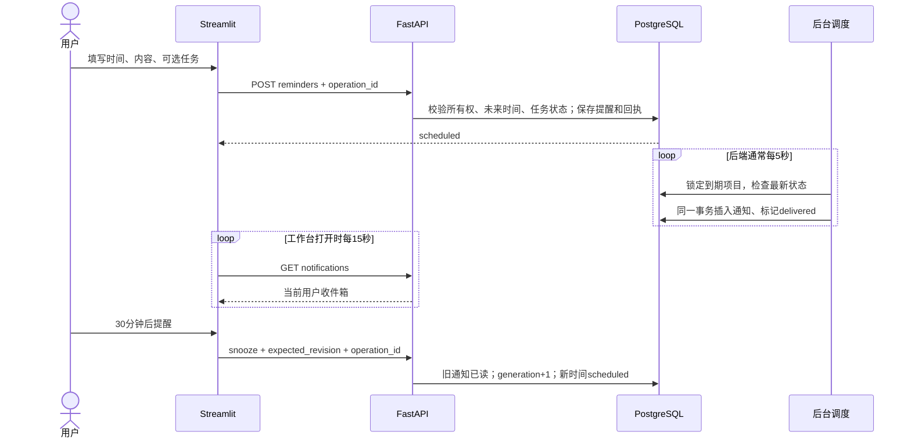

# EchoMind 主动协作第一步：持久站内提醒

日期：2026-10-28（Asia/Shanghai）。接续第一阶段项目工作台，新增一次性提醒、站内收件箱、取消、已读和稍后提醒。工程验收结果见 [本轮交付](personal-assistant-reminders-delivery.md)。

## 1. 产品选择与技术路线

先让助手能按你设定的时间主动跟进项目。进入项目的「提醒」页，填写内容、日期和时间，可选择关联一项未完成任务。到期后，工作台顶部的收件箱出现通知；可以标为已读、打开项目，或30分钟后再次提醒。

时间在界面统一按 Asia/Shanghai 展示。提醒由后端进程处理，关闭浏览器不会丢失；电脑或后端停止时无法即时送达，服务恢复后会补发过期提醒，并展示原计划时间与实际送达时间。工作台打开时每15秒自动检查收件箱；知识对话页面暂不自动刷新收件箱。

| 阶段 | 本轮交付 | 下一步边界 |
|---|---|---|
| E1 持久调度 | 数据表、后台轮询、重启补发、原子投递 | 单次提醒，不包含每日/每周重复规则 |
| E2 站内交互 | 设置、取消、已读、稍后提醒、分页、心跳提示 | 通知保存到站内，不发送邮件或系统推送 |
| E3 可靠性 | 用户隔离、版本、幂等、归档/完成抑制、故障测试 | 不承诺停机时实时送达或生产级SLA |
| 后续 | 实际使用记录、重复规则、外部通知渠道、日历 | 先确定渠道与规则，再设计外部投递回执和授权 |

本轮不新增依赖、模型调用或外部账号连接。提醒为用户表单明确创建，模型还没有设置提醒的写工具。

## 2. 先理解四种数据

阅读 `backend/migrations/011_assistant_reminders.sql`。

| 表 | 含义 | 关键约束 |
|---|---|---|
| `assistant_reminders` | 用户要求在何时提醒什么，关联哪个项目/任务 | 所有权外键；独立revision；状态与generation |
| `assistant_notifications` | 某次提醒已实际进入收件箱 | `(reminder_id,generation)`唯一；计划/实际送达/已读时间 |
| `assistant_reminder_operations` | 用户某次写操作的持久回执 | `(user_id,operation_id)`唯一，保存内容指纹和原结果 |
| `assistant_scheduler_state` | 最近一次成功调度心跳 | 后端扫描成功后更新 |

**提醒与通知不同。** 设置明天09:00提醒时，只有提醒记录；明天到期投递成功后，才有通知。浏览器显示一条卡片只是读取这条通知，并不等于用户已经看过，因此已读需要用户点击。

**项目版本与提醒版本不同。** 调度器投递提醒只递增提醒自己的revision。项目的任务、笔记、模型候选基线版本不会因为定时投递变化，避免一个提醒把尚未采纳的计划变成旧候选。

**稍后提醒不是重复插入原通知。** 第一次提醒generation=1，稍后提醒后generation=2，旧通知保留并标为已读，新时间到达时插入第二次通知。每次generation最多对应一条站内通知。

## 3. 一次提醒如何走完

先读 `backend/assistant/reminders.py` 的 `create`，再读 `dispatch_due`，最后看 `change`。请求路由在 `backend/assistant_api.py`，后台任务在 `backend/main.py` 的生命周期里启动，关闭时统一取消并等待结束。

## 4. 为什么不用一个长时间sleep等待明天

Python进程内的计时状态会随着进程结束消失。本实现持久保存 `due_at`，每次查询 `status='scheduled' AND due_at<=now()`。重启后再次执行查询，过去已经到期但未投递的行仍在，所以自然得到补发列表。没有单独依赖浏览器计时器，也没有把定时状态存在Redis或模型记忆里。

每轮最多处理100条，批次满时短暂等待0.1秒继续清理积压，空闲时通常等5秒。异常不改成成功状态，记录错误并在下一轮重试。心跳30秒没有成功更新时，工作台提示调度延迟；心跳代表扫描进程近期运行过，不等于对每个提醒的实时送达保证。

## 5. 并发、取消和“只发一次”的准确范围

所有修改统一按“项目锁 → 操作锁 → 提醒/通知行”的顺序获取锁。调度扫描用 `FOR UPDATE OF p SKIP LOCKED`，跳过其他进程正处理的项目；下一轮仍会再查。这个方式适合分担队列工作，不用于需要完整一致结果的项目工作台查询。[PostgreSQL SELECT官方说明](https://www.postgresql.org/docs/16/sql-select.html)

插入通知和更新提醒状态处于**同一个数据库事务**：

- 插入后、更新前崩溃：事务回滚，下次重试重新完成两步。
- 提交后进程退出：提醒已经是delivered，下次扫描不再处理。
- 两个调度器同时运行：项目行锁分担工作，通知唯一约束再防重复。
- 取消先提交：扫描不再投递它。
- 投递先提交：提醒revision已变；旧页面的取消返回409，刷新后可取消并把已送达通知标为已读。

因此这里保证的是数据库中同一generation最多一条通知，不能把这个结论扩展成邮件、手机推送“恰好发送一次”。未来接入外部渠道需要额外的发送队列、提供商回执、重试规则和去重策略。

用户请求断网时可能已经提交。前端保留原操作ID和原内容，重试读取原回执；相同ID改内容会返回409。重试已成功的创建，即使原提醒时间已经过去，也返回已有回执，而不会重新创建或因“时间已过”否认成功。

## 6. 任务完成后为什么不再提醒

到期扫描在项目锁内检查当前状态：归档项目、已完成/取消任务、已删除资料范围都会将到期提醒改成cancelled，记录原因，不生成通知。不自动将任务标为完成，也不把“已读提醒”当作“完成工作”。

待提醒事项不会在归档当下立即全部改状态，而是在到期检查时决定是否跳过。如果项目在到期前恢复，仍然可以提醒；如果已经因归档而跳过，恢复项目不会复活原提醒，需要重新设置。已实际送达的历史通知也不会因为后来完成任务而被篡改。

## 7. 时区为什么同时保存两部分

`TIMESTAMPTZ`保存一个时间点，但不保留原始IANA时区名称，所以单独保存timezone。后端要求请求时间显式携带偏移，并验证该偏移与指定时区在该时间点一致；无时区时间、非法时区、夏令时不存在的当地时间会拒绝。未来时间范围由数据库时钟核对，最多365天。[PostgreSQL日期时间类型](https://www.postgresql.org/docs/16/datatype-datetime.html)

例如 `2026-11-01T09:00:00+08:00` + `Asia/Shanghai` 是明确的请求。`2026-11-01T09:00:00` 缺少时区，不能猜测。夏令时重复小时可能有两个合法偏移，API通过显式偏移区分它们；当前界面只提供上海时区，避免增加不必要的选择。

## 8. 页面自动刷新为什么不重跑整个工作台

阅读 `frontend/reminders_ui.py` 的 `render_inbox`。`@st.fragment(run_every='15s')`只刷新收件箱区域，保留外部尚未提交的提醒表单。自动刷新只在浏览器会话活跃时运行，后端调度与它独立。勾选历史、翻页、已读、稍后提醒仍通过正常组件和API完成。[Streamlit fragment官方说明](https://docs.streamlit.io/develop/api-reference/execution-flow/st.fragment)

接口读取都校验当前用户的项目/资料范围，前端不会把用户ID当权限凭证；现有身份中间件决定身份。分页提供has_more和总未读数，不把第一页当成完整历史。每个项目最多100项scheduled提醒，历史通过分页读取。

## 9. 亲手做的四个实验

1. 创建一个几分钟后到期的演示提醒，保持工作台打开，在另一个表单输入未提交草稿。观察提醒自动出现，草稿保持不变。
2. 创建提醒后停止后端，等过期再启动。查看原计划时间和实际送达时间，理解补发与准时送达的差别。
3. 提醒送达后点“30分钟后提醒”，切换“包含已读提醒”查看旧通知；新generation到期才产生新通知。
4. 给一项演示任务设置提醒，先完成任务，再等待到期。项目的提醒历史应显示已取消及原因，收件箱没有新增通知。

进阶阅读 `backend/tests/test_assistant_reminders.py`：测试用随机隔离schema模拟时间推进、双worker、事务中断、断线重试、取消竞争及越权。测试将某条演示时间调整到过去来模拟过期，不改真实项目表；真实浏览器验收另用标记为“示例”的项目。

能回答下面三句话，说明已掌握本轮重点：**数据库里已保存 ≠ 已送达；已送达 ≠ 已读；已读 ≠ 任务完成。**
